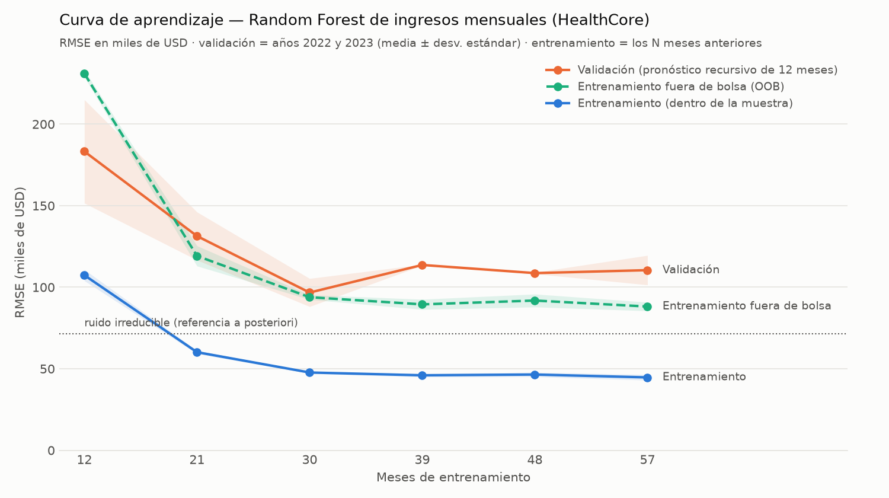
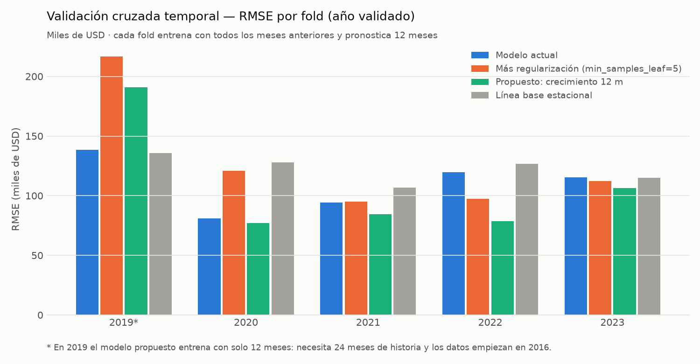

# Reporte de evaluación técnica: modelo de predicción de ventas de HealthCore

**Modelo evaluado:** el `RandomForestRegressor` de
[`scripts/train_sales_forecast.py`](../../scripts/train_sales_forecast.py). Tiene 500
árboles, `min_samples_leaf=2`, `max_features=0.5` y `random_state=42`, y predice
`revenue_usd` de la fila `consolidated` como ratio sobre la media de los 12 meses
anteriores.

**Alcance:** solo los 8 años de entrenamiento (2016–2023). Los años de prueba 2024–2025
no se tocan.

**Reproducción:**

```bash
uv sync
uv run python scripts/evaluate_sales_model.py   # escribe learning_curve.png, cv_folds.png y sales_model_evaluation.json
uv run pytest tests/pipelines/test_temporal_cv.py
```

## Respuestas al ticket

| Pregunta | Respuesta |
| --- | --- |
| ¿Underfitting, overfitting o bien ajustado? | **Bien ajustado.** No hay overfitting: regularizar más empeora la validación. No hay underfitting de la estacionalidad: los picos y valles se predicen con un 1–2 % de error. Queda un **sesgo sistemático en el nivel anual**, pequeño pero corregible. |
| ¿Qué tan estable es si cambia la porción de entrenamiento? | **RMSE de validación de 109,7 k ± 20,2 k USD** en 5 folds temporales (3,2 % ± 0,8 % de MAPE). Desde 30 meses de entrenamiento el error de validación se estabiliza en torno a 110 k: con más historia no mejora ni empeora. |
| Acción correctiva | Sustituir `yoy_growth_3m` por **`yoy_growth_12m`** (el crecimiento de los últimos 12 meses frente a los 12 anteriores) y quitar las 5 features de corto plazo que casi no aportan. En los folds 2020–2023, el RMSE de validación baja de 102,5 k a 86,6 k (−15 %) y el sesgo anual se reduce a la mitad. Detalle en [§ 5](#5-acción-correctiva). |

## 1. Validación cruzada temporal

- **Esquema.** `TimeSeriesSplit(n_splits=5, test_size=12)` sobre las 81 filas de
  entrenamiento con features completas, de 2017-04 a 2023-12. Los primeros 15 meses
  solo sirven de historia para los lags.
- **Folds.** Cada fold entrena con todos los meses anteriores (ventana expansiva: 21, 33,
  45, 57 y 69 meses) y valida **un año natural completo**: 2019, 2020, 2021, 2022 y 2023.
- **Sin barajar.** `temporal_folds()` comprueba en tiempo de ejecución que cada bloque de
  entrenamiento y de validación es contiguo, que el entrenamiento termina antes de la
  validación y que las ventanas de validación avanzan sin solaparse. Un `KFold` con
  `shuffle=True` falla esas comprobaciones, y hay un test que lo verifica.
- **Sin fuga de lags y rolling entre folds:**
  - **Features causales.** Cada fila se calcula solo con los meses anteriores a ella
    (`month_features(month, history)`); nada se calcula sobre la serie completa.
  - **Ajuste por fold.** El `StandardScaler` y el bosque se ajustan dentro de cada fold,
    solo con sus filas de entrenamiento.
  - **Validación recursiva.** El año de validación se pronostica de forma recursiva desde
    la historia que termina en el límite del fold. Los lags de marzo de 2021 son las
    predicciones de enero y febrero de 2021, nunca sus valores reales. Es el mismo
    protocolo que se usará en producción.
  - **Prueba.** `tests/pipelines/test_temporal_cv.py` multiplica ×5 los valores reales
    desde el límite del fold. Las filas de entrenamiento del fold y el pronóstico no
    cambian; solo cambia la métrica.

## 2. Métricas: MAE y RMSE en entrenamiento y validación

Las cifras son la media ± la desviación estándar de los 5 folds, en USD.

| Conjunto | MAE | RMSE | MAPE |
| --- | --- | --- | --- |
| Entrenamiento, dentro de la muestra | 33,7 k ± 1,2 k | 41,3 k ± 1,6 k | 1,3 % |
| Entrenamiento, fuera de bolsa (OOB) | 69,1 k ± 4,4 k | 83,0 k ± 3,9 k | 2,7 % |
| **Validación** (pronóstico de 12 meses) | **92,8 k ± 22,8 k** | **109,7 k ± 20,2 k** | **3,2 % ± 0,8 %** |
| Línea base estacional (validación) | 98,6 k ± 13,7 k | 122,5 k ± 10,3 k | 3,4 % |
| Ruido irreducible (referencia) | — | ≈ 71,5 k | 2,6 % |

**Por fold:**

| Año validado | Meses de entrenamiento | RMSE validación | MAE validación | Sesgo | Crecimiento real del año | RMSE línea base |
| --- | --- | --- | --- | --- | --- | --- |
| 2019 | 21 | 138,5 k | 125,5 k | −3,8 % | +6,9 % (alto) | 135,9 k |
| 2020 | 33 | 80,8 k | 58,8 k | +1,4 % | +2,1 % (bajo) | 128,0 k |
| 2021 | 45 | 94,2 k | 77,4 k | −0,7 % | +5,4 % (alto) | 106,9 k |
| 2022 | 57 | 119,5 k | 101,9 k | +2,7 % | +2,1 % (bajo) | 126,7 k |
| 2023 | 69 | 115,3 k | 100,4 k | −2,6 % | +6,0 % (alto) | 114,9 k |

- **Error dentro de la muestra.** En un Random Forest no es un error de entrenamiento
  válido para diagnosticar. Cada árbol ya vio en su bootstrap la mayoría de las filas
  que se le piden, y con `min_samples_leaf=2` las memoriza por construcción.
- **Error OOB.** Cada fila se predice solo con los árboles que no la vieron. Es la curva
  honesta del lado del entrenamiento, y la que se compara con la validación.
- **Ruido irreducible.** Es el residuo de un ajuste a posteriori con un nivel propio para
  cada año y un efecto por mes. Conoce el nivel de cada año después de que ocurrió, así
  que ningún pronóstico puede bajar de ahí.

### Métrica principal: RMSE

El BRIEFING (`content/contexts/sales-forecasting/healthcore/healthcore-BRIEFING.es.md`)
no dice que un sentido del error sea más barato que el otro, pero sí dónde está el riesgo:

- **Temporada de gripe (octubre–diciembre, +15–20 %).** Es cuando las 12 clínicas
  atienden más consultas. Subestimar un pico significa planificar capacidad y personal
  para un trimestre más tranquilo de lo que será. Es justo el "problema de capacidad
  clínica" que preocupa a Sandra.
- **Verano (julio–agosto, −12–18 %).** Sobrestimar el valle hace que una caída normal
  parezca atípica, o esconde una caída real. Sandra pide distinguir "un agosto normal"
  de "una caída atípica que amerite atención".
- **Fallos grandes.** Para Tom (Revenue Cycle) y Sandra, un fallo de 300 k USD en un mes
  de pico cuesta mucho más que tres fallos de 100 k repartidos en meses normales. El
  primero cambia decisiones de capacidad y de caja; los segundos se absorben en el
  presupuesto del trimestre.

Por eso la métrica principal es el **RMSE**: al elevar al cuadrado, penaliza de forma
desproporcionada los fallos grandes, que es donde está el costo. El MAE trata igual un
error de 300 k que tres de 100 k, y ocultaría justo ese caso.

El MAE se reporta como métrica complementaria, porque es la más fácil de contar ("de
media nos desviamos 93 k USD al mes"). El cociente RMSE/MAE es ≈ 1,18, lo que indica que
hoy no hay fallos extremos aislados: los errores son bastante uniformes. Además se
reporta el **sesgo con signo**, porque ni el MAE ni el RMSE dicen si el error es de más o
de menos, y ese es el error que hay que corregir (ver §5).

## 3. Curva de aprendizaje



**Cómo se construyó:**
- **Validación fija.** Siempre los años 2022 y 2023 (los folds 4 y 5), así que entre un
  punto y otro solo cambia el tamaño del entrenamiento.
- **Entrenamiento.** Los N meses inmediatamente anteriores a cada fold, con N = 12, 21,
  30, 39, 48 y 57.
- **Valores del gráfico.** La media ± la desviación estándar de los dos años.

| Meses de entrenamiento | RMSE en la muestra | RMSE OOB | RMSE validación |
| --- | --- | --- | --- |
| 12 | 107 k | 231 k | 183 k |
| 21 | 60 k | 119 k | 131 k |
| 30 | 48 k | 94 k | 97 k |
| 39 | 46 k | 89 k | 114 k |
| 48 | 46 k | 92 k | 109 k |
| 57 | 45 k | 88 k | 110 k |

**Interpretación del patrón: buen ajuste, con el error estabilizado por encima del ruido.**

1. **De 12 a 30 meses**, la validación cae de 183 k a 97 k. Con menos de 2 años y medio
   el modelo no ha visto suficientes ciclos estacionales. Esa parte es la que mejora con
   más datos, y ya está cubierta: el modelo de producción entrena con 81 meses.
2. **Desde 30 meses**, la validación (≈ 110 k) y el OOB (≈ 90 k) son **planas y
   cercanas**: la diferencia es de unos 20 k USD, un 0,6 % del ingreso mensual. Las dos
   curvas convergen, que es el patrón de un modelo bien ajustado y no el de overfitting.
   - **En la muestra (45 k) frente a validación (110 k).** Esa brecha es el artefacto de
     memorización del bootstrap descrito en §2, no una señal de varianza. La prueba es
     el experimento de regularización: si fuera varianza, regularizar cerraría la
     brecha y mejoraría la validación, y ocurre lo contrario.
3. **No es underfitting.** El nivel en el que convergen (≈ 3,3 % del ingreso medio) está
   cerca del ruido irreducible (2,6 %) y por debajo de la línea base estacional en todos los
   folds salvo 2019 (21 meses de entrenamiento) y 2023 (prácticamente empatado: 115,3 k
   frente a 114,9 k). Además, los meses más difíciles para un modelo sin capacidad son los
   que mejor predice: el error absoluto medio es del 1,2 % en julio, el 2,4 % en agosto,
   el 2,3 % en noviembre y el 2,0 % en diciembre.
4. **La meseta sobre el ruido (≈ 110 k frente a 71,5 k) no se arregla con más datos.**
   Entre 30 y 57 meses la validación no baja. Su causa está en §4.

## 4. Estabilidad y causa del error restante



**Estabilidad.** La desviación estándar es 20,2 k sobre una media de 109,7 k: un
coeficiente de variación del 18 %. El rango por fold va de 80,8 k (2020) a 138,5 k
(2019). El fold de 2019 es el único que entrena con menos de 30 meses (21), justo en la
zona de la curva de aprendizaje donde todavía faltan datos. Sin él, el RMSE es de
102,5 k ± 15,7 k.

**Causa raíz del error que queda.** El sesgo de cada fold **alterna de signo** igual que
el crecimiento del BRIEFING ("cada año, el crecimiento real alterna entre X+Y y X−Y"):

- **Años de crecimiento alto** (2019 +6,9 %, 2021 +5,4 %, 2023 +6,0 %): el modelo
  **subestima** (−3,8 %, −0,7 %, −2,6 %).
- **Años de crecimiento bajo** (2020 +2,1 %, 2022 +2,1 %): **sobrestima** (+1,4 %, +2,7 %).

Coincide en los 5 folds. En 2022 y 2023 ese sesgo de nivel supone ≈ 45–50 % del MSE.

**El motivo.** La única señal de tendencia del modelo es `yoy_growth_3m` (el último
trimestre frente al mismo trimestre del año anterior), que dice "el año que viene crecerá
como este". Con un crecimiento que alterna, eso es exactamente lo contrario de lo que
pasa. Es un **sesgo de especificación de una feature**, no falta de capacidad ni de datos.

**Experimento de regularización (`min_samples_leaf=5`).** Empeora la validación a
128,4 k ± 45,1 k y no reduce el sesgo. Confirma que el problema no es varianza.

## 5. Acción correctiva

**Cambiar el conjunto de features:**
- **Añadir** `yoy_growth_12m = media(últimos 12 meses) / media(los 12 anteriores) − 1`,
  en sustitución de `yoy_growth_3m`. Mide el crecimiento del año completo y permite que
  el modelo aprenda que a un año alto le sigue uno bajo.
- **Quitar** `lag_1_ratio`, `lag_2_ratio`, `lag_3_ratio`, `rolling_mean_3_ratio` y
  `rolling_std_12_ratio`.
  - **Pesan poco.** Juntas suman menos del 7 % de la importancia.
  - **Arrastran errores en el pronóstico recursivo.** A partir del segundo mes, esos
    lags son predicciones del propio modelo, así que propagan sus errores.
- **Mantener** el calendario (`month_of_year`, `month_sin`, `month_cos`,
  `is_flu_season`, `is_summer_dip`) y `lag_12_ratio`.
- **Mantener** los hiperparámetros: el problema no es de varianza.
- **Historia necesaria: 24 meses.** El modelo de producción entrenará con 72 filas en
  lugar de 81.

**Evidencia en los mismos 5 folds** (`experiment_proposed_features` en
`sales_model_evaluation.json`):

| Folds | Modelo actual | Propuesto |
| --- | --- | --- |
| 2020–2023 (entrenamiento ≥ 24 meses), RMSE | 102,5 k | **86,6 k (−15 %)** |
| 2020–2023, MAE | 84,6 k | **74,1 k (−12 %)** |
| 2020–2023, sesgo medio absoluto | 1,86 % | **0,94 %** |
| Los 5 folds, RMSE | 109,7 k ± 20,2 k | 107,5 k ± 43,0 k |

**Los cinco folds juntos.** La media apenas cambia y la desviación sube. Ese efecto es
**solo del fold de 2019**: con 24 meses de historia mínima, el modelo propuesto entrena
allí con 12 meses (un único año) y sube a 191 k. Es la zona de pocos datos de la curva
de aprendizaje, que no se dará en producción. En los 4 folds restantes mejora todos los
años (2020: 80,8 → 76,9 k; 2021: 94,2 → 84,5 k; 2022: 119,5 → 78,8 k; 2023:
115,3 → 106,3 k).

**Qué no se recomienda, y por qué:**
- **Más datos.** La curva es plana desde 30 meses y el modelo ya entrena con 81; más
  historia no corrige un sesgo de especificación.
- **Más regularización o menos profundidad.** Empeora la validación (128,4 k), porque el
  problema no es de varianza.
- **Más complejidad**, como XGBoost o más árboles. El nivel actual ya está cerca del
  ruido y el error restante es de una feature mal especificada, no de capacidad.

**Criterio de aceptación antes de staging:**
1. Aplicar el cambio en `train_sales_forecast.py`.
2. Repetir esta validación cruzada: el RMSE de los folds 2020–2023 debe ser menor de 95 k
   y el sesgo medio absoluto menor del 1,5 %.
3. Solo entonces evaluar **una única vez** sobre 2024–2025.

Los años de prueba no se usaron para elegir esta acción. Si se usaran para decidirla,
dejarían de ser una prueba independiente.

## 6. Limitaciones

- **Pocos puntos.** Son 5 folds de 12 meses: 60 meses de validación. La desviación
  estándar entre folds es orientativa.
- **Patrón por confirmar en datos reales.** El crecimiento alterno viene del BRIEFING y
  se ve en los 10 años del dataset. Si en datos reales dejara de alternar, la nueva
  feature seguiría siendo la señal de tendencia correcta (el crecimiento del último
  año), pero la ganancia sería menor. Hay que revisarlo cuando llegue 2026.
- **Mezcla de regiones.** El dataset solo tiene la fila `consolidated`: no se puede
  evaluar el error por región (EE. UU./Reino Unido).
