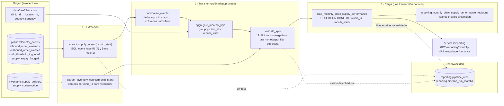

# Diseño — Pipeline de Desempeño de Insumos por Clínica (HealthCore)

**Estado:** diseño (Parte 1 de 3). Todavía no hay código de orquestación.
**Pipeline:** `monthly_clinic_supply_performance`.
**Fuentes de verdad:** BRIEFING de data pipelines de HealthCore (§1–§7), BRIEFING
de telemetría y [`docs/telemetry/`](../../docs/telemetry/).

## Propósito

> Producir cada mes, listo el primer día hábil, el **«Reporte Mensual de
> Desempeño de Insumos por Clínica»** para la Dra. Okonkwo (CEO) y Claire (CCO):
> una fila por clínica y mes en `reporting.monthly_clinic_supply_performance`
> con los cuatro KPIs del BRIEFING:
>
> - **costo de insumos por clínica**, a partir de `inbound_order_created`;
> - **volumen de consumo de insumos**, a partir de `outbound_order_created`;
> - **frecuencia de quiebre crítico**, a partir de `stock_threshold_triggered`;
> - **conteo de riesgo de vencimiento**, a partir de `supply_expiry_flagged`.

Si una etapa de este diseño no sostiene ese reporte, no forma parte de la v1.

---

## 1. Estado actual

### Qué se captura y dónde vive

| Pieza | Estado en el monorepo |
| --- | --- |
| **Contrato de eventos** | `docs/telemetry/event-schemas.json`, versión `2.0.0`: 25 tipos de evento, de los cuales 5 son obligatorios del BRIEFING. Envelope: `eventId`, `timestamp`, `sessionId`, `userId`, `event_type`, `schemaVersion`, `requestId`, `properties`. |
| **Captura** | Backoffice Next.js. Cola en memoria con `track()` y lotes de hasta 20 eventos cada 10 s; `sendBeacon` al ocultar la pestaña; 3 reintentos con backoff. Instrumentados 21 de 25 eventos, incluidos los 5 obligatorios. |
| **Recepción** | `POST /telemetry/events` en FastAPI. Valida cada evento con `TelemetryEvent` y contra el allowlist de su `event_type`. Guarda en un solo `INSERT … ON CONFLICT (id) DO NOTHING` y responde `{received, stored, rejected}`. |
| **Almacenamiento** | `public.telemetry_events` en Supabase (proyecto `healthcore`, `eu-west-2`). Columnas: `id` (= `eventId`, PK), `timestamp`, `service`, `event_type`, `session_id`, `user_id`, `request_id` y `tags` (jsonb con las `properties` del allowlist más `_schema_version`). Un trigger bloquea `UPDATE`/`DELETE`, así que la tabla es solo de inserción. Hoy tiene unas 70 filas reales, todas del 2026-11-21. |
| **Reporte técnico** | `GET /telemetry/report`, con `services/telemetry/analysis.py`. Para ingeniería: eventos por día, distribución por tipo, tasa de error y latencia por ruta de API, errores de frontend y tasa de fallos de login. |
| **Dominio de inventario** | Postgres de inventario (`DATABASE_URL`). Tablas `medical_supply` (con `product_category` y `expiry_date`), `supply_delivery` (entradas), `supply_consumption` (salidas, con `department`) y `clinic_stock_minimum`. `clinic_id` es un entero del 1 al 12. |

Propiedades de los cuatro eventos fuente, tal como llegan hoy en `tags`:

| `event_type` | Propiedades (`tags`) |
| --- | --- |
| `inbound_order_created` | `clinic_id`, `country`, `product_id`, `product_category`, `quantity`, `supplier_id` |
| `outbound_order_created` | `clinic_id`, `country`, `product_id`, `product_category`, `quantity`, `department` |
| `stock_threshold_triggered` | `clinic_id`, `country`, `product_id`, `product_category`, `quantity`, `min_stock_threshold`, `department` |
| `supply_expiry_flagged` | `clinic_id`, `country`, `product_id`, `product_category`, `quantity`, `expiry_date`, `days_until_expiry`, `expiry_window_days` |

### La brecha de negocio

El reporte técnico responde **«¿está sano el sistema?»** (volumen, errores,
latencia) para ingenieros, sobre una ventana móvil de días y calculado al vuelo
con un caché de 60 s. No responde a la pregunta del liderazgo:

> «Este mes, ¿cuánto gastó cada clínica en insumos, cuánto consumió, cuántas
> veces quedó bajo su mínimo y cuántos lotes estuvieron cerca de vencer,
> comparando EE. UU. y Reino Unido?»

| Lo que el reporte de negocio necesita | Por qué el reporte técnico no lo da |
| --- | --- |
| **Costo de compra en dinero** | Ningún evento lleva costo; hoy solo existe `quantity`. |
| **Grano clínica × mes calendario** | El reporte técnico agrupa por día, ruta y tipo de evento; nunca por clínica ni por mes. |
| **Moneda por país de la clínica** | El `country` de la telemetría viene del producto, no de la clínica (brecha documentada en el plan). |
| **Cifras publicadas, persistentes y auditables** | El reporte técnico no guarda nada: se recalcula y caduca. La junta necesita un número que no cambie sin dejar rastro. |
| **Distinguir «cero actividad» de «hueco de captura»** | El reporte técnico no cruza la telemetría con el inventario. |

Por eso hace falta un pipeline dedicado, con su propio destino en el esquema
`reporting`.

---

## 2. Extracción

### Tablas origen

| Origen | Uso | Acceso |
| --- | --- | --- |
| `public.telemetry_events` (Supabase) | Fuente de los 4 KPIs | **Solo lectura**, con el rol `reporting_pipeline`: `SELECT (id, "timestamp", event_type, tags)`. Nunca `session_id`, `user_id` ni `request_id`. |
| Registro de clínicas `data/raw/clinics.csv` | Traducir el `clinic_id` entero a `locationId`, país y moneda | Archivo versionado (ver «Registro de clínicas») |
| `supply_delivery` y `supply_consumption` (Postgres de inventario) | **Solo reconciliación**: comparar conteos para detectar huecos de captura. No alimenta los KPIs. | Solo lectura (`SELECT`) |

No se lee ningún otro `event_type` ni ninguna tabla con datos de pacientes
(§3 del BRIEFING).

### Formato y cadencia

- **Forma de una fila:** `id uuid`, `"timestamp" timestamptz` (momento de
  captura en UTC), `event_type text` y `tags jsonb`. Las propiedades de cada tipo
  están en la tabla de §1. `tags->>'_schema_version'` indica con qué contrato se
  validó el evento.
- **Consulta, una por mes procesado:**

  ```sql
  select id, "timestamp", event_type, tags
  from public.telemetry_events
  where event_type in ('inbound_order_created', 'outbound_order_created',
                       'stock_threshold_triggered', 'supply_expiry_flagged')
    and "timestamp" >= :month_start              -- inclusivo, UTC
    and "timestamp" <  :month_start + interval '1 month'  -- exclusivo
  ```

- **Cómo se actualiza la fuente:**
  - Solo recibe inserciones; las filas nunca se modifican.
  - Llegan casi en tiempo real: el backoffice envía lotes cada 10 s o al cerrar
    la pestaña, y reintenta hasta 3 veces.
  - Pueden llegar eventos **tarde**: una pestaña que reintenta, o un beacon
    entregado después de medianoche o de fin de mes. Por eso el pipeline nunca
    da un mes por cerrado tras una sola corrida (§5, «Eventos tardíos»).

### Registro de clínicas

La telemetría y el inventario identifican la clínica con un entero (1–12). El
reporte usa el vocabulario de clínicas del `CONTEXT` de HealthCore
(`locationId`, por ejemplo `us-tx-001`). `data/raw/clinics.csv` hace la
traducción:

| `clinic_id` (telemetría) | `location_id` (reporte) | `country` | `currency` | Región |
| --- | --- | --- | --- | --- |
| 1–3 | `us-tx-001` … `us-tx-003` | `US` | `USD` | Texas |
| 4–6 | `us-fl-001` … `us-fl-003` | `US` | `USD` | Florida |
| 7–9 | `us-ga-001` … `us-ga-003` | `US` | `USD` | Georgia |
| 10–11 | `uk-lon-001`, `uk-lon-002` | `UK` | `GBP` | Londres |
| 12 | `uk-man-001` | `UK` | `GBP` | Mánchester |

> **Pendiente de confirmar con Operaciones Clínicas (Marcus):**
>
> - El `CONTEXT` solo fija `us-tx-001`, `us-fl-001` y `us-ga-001`. El reparto de
>   los 12 identificadores es una propuesta, coherente con el seed de inventario
>   (clínicas 1–2 en EE. UU. y 10–11 en Reino Unido).
> - Este registro es la **única** fuente de `country` y `currency` del reporte.
>   Si el `country` de un evento (que viene del producto) no coincide, se cuenta
>   como `country_mismatch` en el log; la fila se calcula con el país de la
>   clínica.

### Extensión aditiva requerida: costo en `inbound_order_created`

Ningún evento lleva costo, así que se añade **un campo** al evento obligatorio
existente, sin crear un tipo de evento nuevo (§3 del BRIEFING):

| Cambio | Detalle |
| --- | --- |
| Contrato | `inbound_order_created.properties.total_cost`: `number`, `minimum 0`, 2 decimales, **en la moneda de la clínica**. Contrato `2.0.0` → `2.1.0` (aditivo). |
| Inventario | `supply_delivery.unit_cost numeric(12,2)`, capturado en el formulario de entrada (precio de la factura del proveedor). La API calcula `total_cost = quantity × unit_cost` y lo devuelve en la respuesta del 201. |
| Captura | `createInbound()` lee `total_cost` de esa respuesta y lo añade al evento. |
| Lo que no cambia | El reporte técnico (`analysis.py` y `GET /telemetry/report`) y el esquema de `telemetry_events`: el campo vive dentro de `tags`. |

Los eventos `2.0.0` ya guardados no tienen `total_cost`. **No se toman como
costo 0**: se cuentan aparte como `inbound_without_cost` en el log (§6), y el
reporte del mes avisa de que el costo está incompleto.

---

## 3. Flujo de datos



### Transformación: de evento a fila

Se trabaja con Pandas y sin bucles, siguiendo el mismo orden que el reporte
técnico:

1. **Deduplicar** por `id` (el `eventId`).
2. **Extraer de `tags`:** `clinic_id`, `product_id`, `quantity`, `total_cost`,
   `expiry_date` y `department`.
3. **Convertir** `timestamp` con `pd.to_datetime(..., utc=True)` y derivar
   `month_start` (primer día del mes en UTC).
4. **Unir** con el registro de clínicas (`clinic_id` → `location_id`,
   `country`, `currency`).
5. **Agregar** por `clinic_id` y `month_start`:

| Campo destino | KPI | Regla |
| --- | --- | --- |
| `total_supply_cost` | Costo de insumos por clínica | `sum(total_cost)` de `inbound_order_created`. Los eventos sin `total_cost` no suman y se cuentan aparte. |
| `supply_consumption_count` | Volumen de consumo de insumos | `count(id)` de `outbound_order_created`. |
| `critical_stockout_count` | Frecuencia de quiebre crítico | `count(id)` de `stock_threshold_triggered`. Cada evento ya es un cruce único, porque la API solo lo emite en el flanco de bajada. |
| `expiry_risk_count` | Conteo de riesgo de vencimiento | **Lotes distintos:** `nunique(product_id, expiry_date)` en `supply_expiry_flagged`. El aviso se deduplica por navegador, así que dos navegadores pueden marcar el mismo lote y contar eventos lo inflaría. |
| `currency` | — | Del registro de clínicas: `USD` (US) o `GBP` (UK). Nunca se convierte ni se suma entre monedas (§4 y §7 del BRIEFING). |

El grano es **siempre 12 filas por mes**: se cruza con el registro de clínicas,
así que una clínica sin eventos aparece con ceros y nunca falta. Si es un cero
real o un hueco de captura lo decide la observabilidad (§6, «Observabilidad»), no la ausencia de
la fila.

> **Departamento.** El KPI de volumen se describe «por departamento», pero la
> tabla de destino del BRIEFING tiene grano clínica × mes y no tiene columna
> `department`. La v1 guarda el total por clínica. El desglose por
> `department` queda calculado en `data/process` y se expone como detalle
> opcional del endpoint (§8), sin cambiar la tabla del BRIEFING.

---

## 4. Destino

### Tabla del BRIEFING (exacta)

```sql
create schema if not exists reporting;

create table reporting.monthly_clinic_supply_performance (
  id uuid primary key default gen_random_uuid(),
  clinic_id text not null,             -- location_id del registro, p. ej. 'us-tx-001'
  country text not null,               -- 'US' | 'UK', del registro de clínicas
  month_start date not null,           -- primer día del mes, UTC
  total_supply_cost numeric not null default 0,
  supply_consumption_count integer not null default 0,
  critical_stockout_count integer not null default 0,
  expiry_risk_count integer not null default 0,
  currency text not null,              -- 'USD' | 'GBP'
  computed_at timestamptz not null default now(),
  unique (clinic_id, month_start)
);
```

### Tablas de control (también en `reporting`)

| Tabla | Para qué |
| --- | --- |
| `reporting.pipeline_runs` | Log de ejecución: una fila por corrida (§6, «Log de ejecución»). |
| `reporting.pipeline_run_months` | Checkpoint por mes dentro de una corrida (estado, conteos de origen y avisos). Sirve para retomar y para comparar corridas. |
| `reporting.monthly_clinic_supply_performance_revisions` | Solo inserción: guarda los valores anteriores de una fila cada vez que una recarga los cambia. Es el rastro de auditoría de las cifras ya publicadas. |

Reglas de acceso:

- **Nada de este pipeline se escribe en `telemetry_events`.**
- El rol `reporting_pipeline` solo escribe en el esquema `reporting`.
- El backend lee el esquema `reporting` con un rol de solo lectura.

---

## 5. Actualizaciones de registros existentes

### Fuente

`telemetry_events` nunca actualiza filas, porque el trigger lo impide. Una
corrección de negocio, como una entrada mal registrada, llega como un **evento
nuevo**, nunca como una edición. Por eso el pipeline no puede «aplicar deltas»:
**recalcula el mes completo desde la fuente** cada vez. Si una corrida lo
procesa, el resultado depende solo de los eventos del mes, y no de corridas
anteriores ni del orden de llegada.

### Destino: upsert por la clave del negocio

Cada fila recalculada se escribe con:

```sql
insert into reporting.monthly_clinic_supply_performance as t
  (clinic_id, country, month_start, total_supply_cost, supply_consumption_count,
   critical_stockout_count, expiry_risk_count, currency, computed_at)
values (...)
on conflict (clinic_id, month_start) do update set
  country = excluded.country,
  total_supply_cost = excluded.total_supply_cost,
  supply_consumption_count = excluded.supply_consumption_count,
  critical_stockout_count = excluded.critical_stockout_count,
  expiry_risk_count = excluded.expiry_risk_count,
  currency = excluded.currency,
  computed_at = excluded.computed_at
where (t.total_supply_cost, t.supply_consumption_count, t.critical_stockout_count,
       t.expiry_risk_count, t.country, t.currency)
   is distinct from
      (excluded.total_supply_cost, excluded.supply_consumption_count,
       excluded.critical_stockout_count, excluded.expiry_risk_count,
       excluded.country, excluded.currency);
```

- **Clave:** `unique (clinic_id, month_start)`, el constraint del BRIEFING.
  Nunca puede haber dos filas para la misma clínica y mes.
- **Cláusula `where … is distinct from`:** una recarga con los mismos números no
  toca la fila. `computed_at` solo avanza cuando el dato cambió de verdad, y así
  identifica la última modificación real.
- **Antes del upsert,** en la misma transacción, se insertan en `…_revisions`
  los valores anteriores de las filas que **sí** van a cambiar, con `run_id`, el
  motivo (`late_events` o `backfill`) y el momento del cambio.

### Eventos tardíos

- **Ventana de recálculo:** cada corrida programada recalcula el **mes en curso
  y el anterior**. `late_window_months = 1` es configurable en el bloque de
  Prefect.
- **Detección:** como `telemetry_events` no guarda la hora de inserción y su
  esquema no se puede cambiar en este hito, el cambio se detecta comparando
  `source_event_counts` (los conteos por `event_type` del mes) con los de la
  última corrida completada de ese mes en `pipeline_run_months`.
- **Si un evento tardío cambia el mes:** la fila se actualiza, la revisión guarda
  la cifra anterior y el endpoint marca el mes como `revised: true`. No se infla
  nada, porque el mes se recalcula entero y no se suma encima.
- **Meses fuera de la ventana:** solo cambian con el flow de backfill (§7), que
  deja el mismo rastro.

---

## 6. Idempotencia, observabilidad y log de ejecución

### Idempotencia: qué pasa en la segunda corrida tras un fallo en la carga

**Unidad de trabajo:** un mes. La carga de un mes ocurre en **una sola
transacción**, que incluye las revisiones, el upsert de las 12 filas y el
checkpoint del mes en `pipeline_run_months`.

| Escenario | Primera corrida | Segunda corrida |
| --- | --- | --- |
| **Muere durante la carga** (conexión caída, proceso matado) | La transacción del mes se revierte entera. No queda ninguna fila a medias: la tabla tiene exactamente lo de la última carga confirmada. `pipeline_runs.status` queda en `failed` (o `running` huérfano, ver «Recuperabilidad»). | Vuelve a extraer y recalcular el mes desde la fuente y hace el mismo upsert. Como la clave es `(clinic_id, month_start)`, el resultado es idéntico al de una corrida limpia: ni duplicados ni sumas sobre lo anterior. |
| **Falla entre meses** (mes N confirmado, N+1 no) | N tiene checkpoint `completed`; N+1, ninguno. | Si es reintento de la misma corrida (retry de Prefect), salta los meses `completed` y retoma en N+1. Una corrida nueva los recalcula todos; también da el mismo resultado, solo tarda más. |
| **Misma corrida dos veces sin cambios en la fuente** | Escribe las filas. | El upsert no cambia nada por la cláusula `where … is distinct from`: `rows_changed = 0`, sin revisiones nuevas y `computed_at` intacto. |
| **Evento duplicado en el origen** (reintento del navegador) | No llega a duplicarse: `telemetry_events.id` es la PK, con `ON CONFLICT DO NOTHING` en la ingesta. | Además, la transformación deduplica por `id` por si se lee una fuente sin esa garantía (un backfill desde un export, por ejemplo). |
| **Lote vencido marcado por varios navegadores** | Hay N eventos con distinto `id`. | `expiry_risk_count` cuenta **lotes** distintos `(product_id, expiry_date)`, así que siguen siendo 1. |

### Log de ejecución: `reporting.pipeline_runs`

| Campo | Tipo | Por qué hace falta para auditar |
| --- | --- | --- |
| `run_id` | `uuid` PK | Identifica la corrida. Las revisiones y los checkpoints apuntan a él, lo que permite rastrear qué corrida produjo cada cifra publicada. |
| `pipeline_name` | `text` | Distingue `monthly_clinic_supply_performance` de futuros pipelines que reutilicen la tabla y el endpoint `pipeline-runs/latest`. |
| `flow_run_id` | `text` | El ID de la corrida en Prefect. Enlaza el log de negocio con los logs y estados detallados del orquestador. |
| `trigger` | `text` (`scheduled` / `manual` / `backfill`) | Explica por qué corrió. Una cifra que cambió fuera del horario programado tiene que tener un disparo manual o un backfill detrás. |
| `triggered_by` | `text` null | Seudónimo HMAC del usuario que hizo el disparo manual, igual que el `userId` de telemetría. Nunca un email ni un nombre. Responde a «quién la cambió». |
| `months` | `date[]` | Los meses que abarca la corrida. Sin esto no se sabe qué parte de la tabla tocó. |
| `started_at` | `timestamptz` | Inicio. Permite medir la duración y detectar corridas solapadas. |
| `finished_at` | `timestamptz` null | Fin. Un `null` con `started_at` antiguo indica una corrida colgada o muerta, distinta de una que nunca empezó. |
| `status` | `text` (`running` / `completed` / `failed` / `skipped_locked`) | El estado final. Es lo que devuelve `GET /reporting/pipeline-runs/latest`, y separa «no corrió» de «corrió y falló». |
| `source_events_read` | `integer` | Eventos leídos de `telemetry_events`. Si es 0 en un mes con actividad, señala un problema de captura y no un negocio parado. |
| `events_skipped` | `jsonb` | Descartados por motivo: `{"unknown_clinic": n, "inbound_without_cost": n, "invalid_tags": n, "country_mismatch": n}`. Dice exactamente qué no entró en los números y por qué. |
| `rows_upserted` / `rows_changed` | `integer` | Filas escritas y filas cuyo valor cambió. Distingue una recarga sin cambios de una revisión de cifras publicadas. |
| `error_stage` | `text` null (`extract` / `transform` / `validate` / `load`) | La etapa donde falló, para saber si el problema es la fuente, los datos o el destino. |
| `error_message` | `text` null | Clase y mensaje del error, sin datos de eventos ni PII. |
| `code_version` | `text` | Commit del código. Si las cifras cambian tras un despliegue, se puede atribuir el cambio a la lógica y no a los datos. |

`reporting.pipeline_run_months` guarda, por `run_id` y `month_start`:

- `status`;
- `source_event_counts` (jsonb con los conteos por `event_type`);
- `inventory_counts` (entradas y salidas por clínica en el inventario);
- `clinics_without_events` y `coverage` (§6, «Observabilidad»);
- `completed_at`.

### Observabilidad

- **Silencio vs. ausencia real.** Se distinguen tres casos:
  - **El pipeline no corrió:** no hay fila en `pipeline_runs` para el periodo.
    `GET /reporting/pipeline-runs/latest` muestra la última fecha, y un mes sin
    corrida `completed` se presenta como «sin calcular», nunca como ceros.
  - **Falla de captura:** una clínica sin **ningún** evento del mes, de ningún
    tipo (incluidos los técnicos del reporte de ingeniería), mientras el
    inventario sí tiene entradas o salidas suyas. Va a `clinics_without_events`
    y produce un aviso.
  - **Cero actividad real:** la clínica sí tiene telemetría (otros eventos,
    navegación…) y el inventario tampoco registra movimientos. El cero es
    legítimo.
- **Trazabilidad evento → reporte:**
  - `month_start` viene del `timestamp` del evento.
  - Cada fila tiene el `run_id` de su última revisión en
    `pipeline_run_months`.
  - Cada revisión guarda los valores anteriores.
  - Los huecos y las ráfagas se ven comparando `source_event_counts` por día
    dentro del mes. Ese cálculo es de diagnóstico y no se publica.
- **Crecimiento vs. pérdida de datos:**
  - Cada mes se calcula la **cobertura** por clínica: salidas en telemetría
    entre salidas en el inventario, y lo mismo con las entradas.
  - Una cobertura cercana a 1 con más volumen significa que el negocio creció.
  - Si el volumen baja y la cobertura también, se están perdiendo eventos.
  - Una cobertura por encima de 1 indica duplicados o eventos de prueba.
  - Si la cobertura sale de `[0.95, 1.05]`, la corrida termina `completed` pero
    con un aviso en `events_skipped`/`coverage`, y el mes no se marca como
    «listo para la junta».
- **Integridad:** `validate_kpis` comprueba que haya 12 filas por mes, que no
  haya valores negativos, que cada fila tenga una sola moneda coherente con su
  país, y que ningún nombre de columna o valor parezca un identificador de
  paciente. Si falla, la carga del mes no se ejecuta.

### Recuperabilidad

- **Caída de la base de datos:**
  - El checkpoint es el mes: `pipeline_run_months.status = completed` se escribe
    **en la misma transacción** que la carga.
  - Si la conexión se cae, el mes en curso se revierte y el checkpoint no
    existe. El reintento empieza por ese mes; los anteriores ya están
    confirmados.
  - Las tareas de Prefect reintentan 3 veces con espera exponencial ante errores
    de conexión.
- **Corridas huérfanas:** una corrida `running` sin `finished_at` y sin el lock
  activo («Corridas concurrentes») se marca `failed` al empezar la siguiente.
- **Reintentos de transmisión** (ya implementados en la ingesta):
  - El cliente reenvía con el mismo `eventId`.
  - `200` con `{received, stored, rejected}` significa **«ya almacenado»**: los
    duplicados cuentan como `stored`.
  - `503` significa **«reintentar»**.
  - `422` significa que el envelope no es válido y no se reintenta.
  - El reintento no rompe la idempotencia porque el `INSERT` usa
    `ON CONFLICT (id) DO NOTHING`.
- **Buffer offline en el navegador:** **no** se implementa en la v1.
  - La cola en memoria y `sendBeacon` cubren el cierre de pestaña.
  - Persistir eventos en `localStorage` o IndexedDB los dejaría en un equipo
    compartido de la clínica. No llevan PHI, pero sí IDs operativos y un
    seudónimo de usuario. Además reenviaría eventos con días de retraso y haría
    crecer el problema de los eventos tardíos.
  - El riesgo de pérdida lo asume la capa de observabilidad, que lo detecta con
    la cobertura contra el inventario, y no el navegador.

### Corridas concurrentes

El cron y un disparo manual (`POST /reporting/pipeline-runs`) pueden
solaparse. Hay dos defensas:

1. **Lock de base de datos:** al empezar, el flow hace
   `pg_try_advisory_lock(hashtext('monthly_clinic_supply_performance'))`. Si no
   lo obtiene, registra `status = skipped_locked` y termina sin escribir nada.
   `POST /reporting/pipeline-runs` comprueba antes la última corrida y responde
   `409 Conflict` si hay una en curso.
2. **Límite de concurrencia en Prefect:** la etiqueta
   `reporting-monthly-supply` tiene un límite de 1.

Aunque las dos defensas fallaran, el resultado sería correcto. Cada mes se
escribe con un upsert dentro de una transacción con la clave única, así que la
última escritura gana con números recalculados de la misma fuente. Lo único que
podría repetirse es una revisión en el historial, y las revisiones solo se
insertan cuando el valor cambia de verdad.

---

## 7. Mapeo a Prefect

| Concepto de Prefect | En este pipeline |
| --- | --- |
| **Flow principal** | `monthly_clinic_supply_performance_flow(months: list[date] \| None = None, trigger: str = "scheduled")`. Si no recibe meses, usa el mes en curso y el anterior. |
| **Flow opcional** | `backfill_monthly_clinic_supply_performance_flow(start_month, end_month)`: recorre el rango y llama al flow principal con `trigger="backfill"`. |
| **Tasks** | `acquire_run_lock` → `extract_supply_events(month_start)` → `extract_inventory_counts(month_start)` → `transform_monthly_clinic_kpis(events, clinics)` → `validate_kpis(frame, inventory_counts)` → `load_monthly_clinic_supply_performance(frame, run_id)` → `record_pipeline_run(run_id, summary)` |
| **Reintentos** | `extract_*` y `load_*` reintentan 3 veces (`retry_delay_seconds=[10, 30, 90]`). `transform` y `validate` no reintentan, porque son deterministas y un fallo ahí es un problema de datos, no transitorio. |
| **Concurrencia** | Etiqueta `reporting-monthly-supply` con un límite de 1. |
| **Programación** | Deployment con cron `0 5 * * *` (UTC, diario): mantiene el mes en curso al día y absorbe eventos tardíos del anterior. El primer día hábil, el mes anterior ya está calculado y revisado. |

Estados relevantes de Prefect:

| Estado | Qué significa aquí | Qué refleja `pipeline_runs.status` |
| --- | --- | --- |
| `Scheduled` / `Pending` | Corrida programada o disparada que espera turno | Todavía no hay fila |
| `Running` | Extracción, transformación o carga en curso | `running` |
| `Retrying` | Una task de extracción o carga reintenta tras un error transitorio | Sigue en `running` |
| `Completed` | Todos los meses confirmados | `completed`, con conteos |
| `Failed` | Error no recuperable o reintentos agotados | `failed`, con `error_stage` y `error_message` |
| `Crashed` | El proceso murió sin reportar | `running` huérfano; la siguiente corrida lo marca `failed` (§6) |
| `Cancelled` | Cancelado a mano desde la UI de Prefect | `failed`, con `error_message = cancelled` |

**Blocks de Prefect** (las credenciales nunca van en el código ni en el
repositorio):

| Block | Tipo | Contenido |
| --- | --- | --- |
| `healthcore-telemetry-readonly` | `Secret` | URL de Postgres del rol `reporting_pipeline` en el pooler de Supabase (`aws-1-eu-west-2`, puerto 6543), con lectura de `telemetry_events`. |
| `healthcore-reporting-writer` | `Secret` | URL con permiso de escritura **solo** en el esquema `reporting`. |
| `healthcore-inventory-readonly` | `Secret` | URL de solo lectura del Postgres de inventario, para la reconciliación. |
| `monthly-clinic-supply-config` | `JSON` | `{"late_window_months": 1, "expected_clinics": 12, "coverage_tolerance": 0.05, "clinic_registry_path": "data/raw/clinics.csv"}` |

### Estructura de archivos prevista

```text
data/
  raw/clinics.csv                               # registro de clínicas (§2, «Registro de clínicas»)
  process/supply_kpis.py                        # transformaciones puras de Pandas (testeables sin Prefect)
  pipelines/
    PIPELINE_DESIGN.md                          # este documento
    monthly_clinic_supply_performance.py        # flows, tasks y funciones de consulta para services/
    run_log.py                                  # lectura y escritura de reporting.pipeline_runs
services/
  reporting/                                    # router FastAPI: solo HTTP, sin lógica de ETL
```

---

## 8. Integración con la aplicación: `services/reporting/`

Es un módulo nuevo, separado de `services/telemetry/` y de
`GET /telemetry/report`. **Ninguna lógica de ETL vive en `services/`**: el
router valida la petición HTTP, comprueba la sesión y el rol, y llama a una
función importada de `data/pipelines/`. Nunca ocurre al revés.

| Endpoint | Para qué | Importa de `data/pipelines/` | Respuesta |
| --- | --- | --- | --- |
| `GET /reporting/monthly-clinic-supply-performance?month_start=YYYY-MM-01` | Feed de KPIs para el reporte de la junta y el dashboard de la Parte 3. Sin parámetro, devuelve el último mes calculado. | `monthly_clinic_supply_performance.get_monthly_clinic_supply_performance(month_start: date \| None)`: solo lee `reporting.monthly_clinic_supply_performance` y `pipeline_run_months`. | El JSON del BRIEFING (§6) con `month_start` y `clinics[]`, más `revised` y `coverage_warnings` por mes. `clinic_id` usa el `location_id` (`us-tx-001`…). |
| `GET /reporting/pipeline-runs/latest` | Estado de la última corrida: si se calculó, cuándo, con cuántos eventos y si falló. | `run_log.get_latest_run(pipeline_name="monthly_clinic_supply_performance")` | `run_id`, `status`, `trigger`, `started_at`, `finished_at`, `months`, `source_events_read`, `rows_changed`, `events_skipped`, `error_stage`. |
| `POST /reporting/pipeline-runs` | Disparo manual, con body opcional `{"months": ["2026-11-01"]}` | `monthly_clinic_supply_performance.trigger_run(months, triggered_by)`: lanza el deployment de Prefect (`run_deployment(..., timeout=0)`) y no ejecuta el ETL dentro de la petición. | `202 Accepted` con `run_id` y `flow_run_id`; `409` si ya hay una corrida en curso. |

Acceso:

- Los tres endpoints exigen sesión.
- `POST` está restringido a `admin` o `manager`.
- `triggered_by` es el seudónimo HMAC del usuario.
- El backend lee `reporting` con un rol de solo lectura distinto del que usa el
  pipeline para escribir.

---

## 9. Alcance de la v1 y restricciones

- **Dentro:**
  - los 4 `event_type` del BRIEFING;
  - las 12 clínicas;
  - grano clínica × mes;
  - USD y GBP lado a lado.
- **Fuera:**
  - conversión de moneda;
  - joins con tablas de pacientes;
  - eventos fuera de los cuatro;
  - cambios en `services/telemetry/analysis.py`, en `GET /telemetry/report` o en
    el esquema de `telemetry_events`;
  - escribir en `telemetry_events`.
- **Privacidad (HIPAA / UK GDPR):** las filas, las respuestas y el log solo
  contienen agregados por `clinic` (y `department` en el detalle). El pipeline no
  lee `session_id`, `user_id` ni `request_id`, y en el log solo aparece el
  seudónimo de quien hace un disparo manual.
- **Riesgos abiertos:**
  - el costo de los eventos `2.0.0` ya guardados queda incompleto (se avisa, no
    se inventa);
  - el registro de clínicas está pendiente de confirmar;
  - la cobertura depende de que el inventario y la telemetría usen el mismo
    `clinic_id`.
