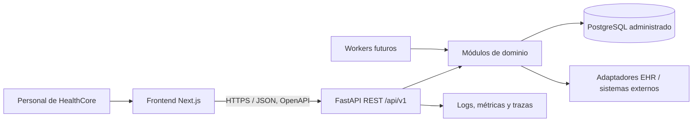

# Propuesta de arquitectura backend — HealthCore Digital

**Estado:** borrador para revisión del CTO y responsables de dominio  
**Fecha:** 2 de noviembre de 2026  
**Decisión principal:** monolito modular con organización por dominios y capas, FastAPI, API REST versionada y base de datos relacional administrada.

## Resumen ejecutivo

Propongo comenzar con una sola API de HealthCore desplegable como unidad, organizada por dominios de negocio y con límites explícitos entre módulos. FastAPI permite mantener las rutas de cada dominio en `APIRouter` separados e incluirlos en una aplicación común. Esta opción mantiene bajo el coste operativo inicial y permite extraer servicios más adelante si una necesidad medible lo justifica.

La API será independiente de las interfaces web: el frontend Next.js consumirá contratos HTTP/OpenAPI; no accederá directamente a la base de datos ni contendrá reglas de negocio. PostgreSQL será la primera opción de persistencia por las relaciones y restricciones entre clínicas, citas, claims y profesionales. Integraciones con EHR se encapsularán en adaptadores, sin convertir la API en un reemplazo prematuro de los sistemas clínicos existentes.

## Contexto y alcance

HealthCore opera 12 clínicas en Estados Unidos y Reino Unido, atiende aproximadamente 600 visitas semanales y emplea a más de 200 personas clínicas y administrativas. El contexto de negocio identifica tres necesidades operativas prioritarias:

- Seguimiento de claims y análisis de denegaciones para facturación.
- Estimación semanal del coste de citas `no_show` por clínica.
- Seguimiento de horas CME y vencimientos de licencias profesionales.

La propuesta también considera el objetivo de conectar clínicas con distintos EHR mediante una capa de datos común, sin asumir que todos los EHR tengan el mismo modelo o permitan las mismas operaciones.

**Límite importante:** este documento diseña la futura API operativa interna de HealthCore. No propone reimplementar la API externa de Talent Tracker, consumida por la aplicación del hito de selección; son sistemas y contratos distintos hasta que el negocio apruebe una integración explícita.

## Decisión arquitectónica

### Monolito modular, no microservicios iniciales

Una única aplicación FastAPI contendrá módulos con propiedad clara sobre sus reglas, modelos y rutas. Se desplegará como una unidad al inicio.

Esto encaja con el estado conocido del proyecto: el volumen descrito es moderado, las necesidades son informes operativos y coordinación entre sedes, y todavía no hay evidencia de equipos autónomos, escalado desigual o requisitos de disponibilidad por dominio que justifiquen servicios separados. Un monolito modular evita introducir desde el primer sprint despliegues múltiples, autenticación entre servicios, observabilidad distribuida y consistencia eventual.

La modularidad no significa compartir cualquier tabla o importar lógica de otro dominio. Cada módulo expondrá operaciones de aplicación y contratos estables; las dependencias entre dominios deberán ser explícitas. Se considerará extraer un servicio solo ante una necesidad demostrada de escalado, aislamiento de fallos, ciclo de despliegue o propiedad organizativa independiente.

### Organización por dominios y capas

La decisión combina dos criterios, no dos alternativas: los **dominios** (`billing`, `appointments`, `compliance`, etc.) definen quién es responsable de cada regla y dato; dentro de cada dominio, las **capas** separan transporte HTTP, casos de uso y persistencia. Es una arquitectura en capas aplicada dentro de un monolito modular. No propongo MVC como estructura principal porque el sistema es una API sin vistas de servidor: los esquemas Pydantic representan contratos de entrada/salida, no páginas. Tampoco propongo serverless ni microservicios como punto de partida, ya que el contexto no demuestra que sus ventajas compensen la operación adicional.

### Sistemas separados por responsabilidad



El frontend y el backend se construyen, configuran y despliegan por separado. El backend controla autorización, validación de dominio, persistencia y acceso a integraciones. El frontend se ocupa de presentación y experiencia; el contrato OpenAPI es el acuerdo entre ambos.

### Monorepo, comunicación y configuración

Propongo conservar inicialmente ambos sistemas en el monorepo existente: el backend en `services/healthcore-api/` y las interfaces en sus directorios actuales bajo `uis/`. Esto permite revisar en un mismo cambio una evolución coordinada del contrato y su consumidor, sin acoplar sus ciclos de ejecución. Cada aplicación tendrá dependencias, pruebas, configuración y pipeline de despliegue propios; un cambio de interfaz no debe obligar a desplegar la API y viceversa. Si más adelante hay equipos, permisos de acceso o ritmos de release que necesiten aislamiento, el backend puede pasar a otro repositorio sin cambiar la comunicación HTTP ni la propiedad de los dominios. Un monorepo no implica compartir base de datos ni importar código interno entre frontend y API.

El frontend se comunicará con la API mediante HTTPS y JSON, usando rutas versionadas bajo `/api/v1`; no se conectará directamente a PostgreSQL. Las URL base y las opciones no secretas se configuran por entorno. Por ejemplo, la interfaz puede recibir `NEXT_PUBLIC_API_URL` como URL pública del backend, mientras que credenciales de base de datos, claves de integración y secretos de autenticación pertenecen únicamente al backend y al gestor de secretos. No se incluirán secretos en variables `NEXT_PUBLIC_*`, porque Next.js las expone al código del navegador.

Al estar en orígenes distintos durante desarrollo y posiblemente en producción, el navegador requiere que la API configure CORS. La lista de orígenes permitidos se mantendrá por entorno (por ejemplo, el origen local de desarrollo y los dominios de frontend aprobados), con métodos y cabeceras explícitos. No se habilitará `*` en producción, especialmente con credenciales; CORS tampoco sustituye autenticación ni autorización. Si el frontend usa cookies, el equipo deberá definir explícitamente credenciales, atributos seguros de cookie y protección CSRF.

## Dominios y límites

| Módulo | Responsabilidad inicial | Datos principales |
| --- | --- | --- |
| `locations` | Catálogo de clínicas, país, zona horaria y metadatos operativos | Ubicación y configuración por sede |
| `appointments` | Estado y fechas de citas; clasificación de `no_show` | Cita, estado, clínica y tipo de servicio |
| `billing` | Ingreso y seguimiento de claims, payer y motivo de denegación | Claim, payer, estado y reenvío |
| `workforce` | Profesionales, rol, sede y licencia | Clínico, jurisdicción y vencimiento |
| `compliance` | Ciclos CME, progreso y alertas de cumplimiento | Requisito y horas registradas |
| `reporting` | Tasas de denegación, coste de no-shows y reportes CME | Consultas/proyecciones derivadas de los dominios anteriores |
| `integrations` | Adaptadores y sincronización con EHR y sistemas externos | IDs externos, mapeos, cursores y errores de sincronización |
| `identity` / `audit` | Identidad, permisos y trazabilidad de operaciones sensibles | Usuario, rol, evento y objeto afectado |

`reporting` no será propietario de copias editables de claims, citas o clínicos. En el primer alcance calculará lecturas agregadas mediante consultas optimizadas sobre datos canónicos; si la carga crece, se evaluarán vistas materializadas o un almacén analítico aparte.

## Organización propuesta del código

```text
services/healthcore-api/
├── app/
│   ├── main.py                  # Crear app, middleware y router raíz
│   ├── api/v1/router.py         # Componer routers versionados
│   ├── dependencies.py          # Dependencias HTTP compartidas
│   ├── core/                    # Configuración, seguridad y logging
│   ├── db/                      # Sesiones, base declarativa y transacciones
│   ├── domains/
│   │   ├── locations/
│   │   ├── appointments/
│   │   ├── billing/
│   │   ├── workforce/
│   │   ├── compliance/
│   │   ├── reporting/
│   │   └── integrations/
│   ├── identity/                # Integración con proveedor de identidad
│   └── observability/           # Health checks y métricas de aplicación
├── migrations/                  # Migraciones versionadas de Alembic
├── tests/
│   ├── unit/
│   ├── integration/
│   └── contract/
├── pyproject.toml
└── README.md
```

Dentro de cada dominio, empezar con una estructura pequeña y consistente, y añadir capas cuando haya responsabilidades reales:

```text
appointments/
├── __init__.py
├── router.py       # HTTP: parámetros, códigos y serialización
├── schemas.py      # DTOs de entrada/salida (Pydantic)
├── service.py      # Casos de uso y reglas del dominio
├── repository.py   # Consultas y persistencia
└── models.py       # Mapeo relacional, si corresponde
```

Los routers deben ser delgados: no contienen SQL ni cálculos de reportes. Los servicios de aplicación coordinan reglas y transacciones; los repositorios aíslan detalles de persistencia. No hace falta imponer una capa genérica de repositorio para cada tabla ni duplicar cada esquema sin una razón.

Esta propuesta sigue la guía oficial de FastAPI para aplicaciones mayores: paquetes Python con `__init__.py`, un módulo `main.py`, módulos separados y `APIRouter` por conjunto de operaciones, incluidos en un router principal; dependencias reutilizables se agrupan fuera de las rutas. La guía ofrece un ejemplo con routers `users` e `items`, pero no prescribe una única arquitectura de dominio. Aquí se adopta esa composición y se organiza cada router bajo su dominio para que las convenciones del framework sirvan a los límites del negocio. La separación entre `schemas.py` (contrato API) y `models.py` (persistencia) evita confundir validación/serialización con las tablas de base de datos.

## API y rutas iniciales

Prefijo común: `/api/v1`. La versión se mantiene en la URL para hacer evolucionar contratos de clientes independientes. FastAPI genera OpenAPI y Swagger UI a partir de las rutas y esquemas.

| Dominio | Ejemplos iniciales de recursos |
| --- | --- |
| Clínicas | `GET /api/v1/locations`, `GET /api/v1/locations/{location_id}` |
| Citas | `GET /api/v1/appointments`, `GET /api/v1/appointments/{appointment_id}` |
| Facturación | `GET /api/v1/claims`, `GET /api/v1/claims/{claim_id}` |
| Personal clínico | `GET /api/v1/clinicians`, `GET /api/v1/clinicians/{clinician_id}` |
| Reportes | `GET /api/v1/reports/denial-rates`, `GET /api/v1/reports/no-show-costs`, `GET /api/v1/reports/cme-compliance` |

Son propuestas para iniciar el diseño, no contratos aprobados. Definir filtros, paginación, permisos y formatos de error con los consumidores antes de implementar. Los reportes deben incluir periodo y zona/ubicación de forma explícita para evitar comparar agregados distintos.

## Persistencia y datos

- Empezar con PostgreSQL administrado y SQLAlchemy 2; usar Alembic para migraciones revisables y desplegables. Validar con un prototipo de esquema antes de fijar detalles de infraestructura.
- Aplicar claves foráneas, restricciones y transacciones para mantener integridad entre ubicación, cita, claim y clínico.
- Mantener IDs externos de los EHR además de IDs internos; no asumir que los identificadores de pacientes son globalmente únicos entre sistemas.
- Registrar origen, instante de sincronización y resultado para datos importados. Resolver conflictos y reintentos según reglas acordadas con cada sistema de origen.
- Guardar instantes en UTC y conservar la zona horaria IANA de cada clínica para interpretar horarios locales y agrupar semanas correctamente.
- El contexto operativo de `CONTEXT-healthcore.es .md` expresa tarifas medias en USD incluso para ubicaciones del Reino Unido. Antes de reportar dinero entre países, confirmar moneda de origen, moneda de presentación y política de conversión; no sumar monedas distintas.
- No incorporar historiales clínicos completos al primer alcance. Si se necesitan datos de paciente, acordar finalidad, minimización, retención y fuente de verdad antes de exponerlos en la API.

## Seguridad y privacidad

Los datos de pacientes, claims y licencias pueden ser sensibles. La API debe aplicar autenticación corporativa (OIDC/SSO si está disponible), autorización por rol y sede, y principio de mínimo privilegio. Los roles concretos deben acordarse con responsables de facturación, operaciones clínicas y People/Compliance; no se codifican permisos supuestos.

Registrar auditoría para cambios sensibles y accesos que lo requieran. Evitar PII/PHI en logs, trazas, mensajes de error y métricas. Usar HTTPS, secretos fuera del repositorio, cifrado administrado en tránsito y reposo, backups probados y políticas de retención. CORS debe permitir únicamente los orígenes reales de frontend por entorno; no usar `*` en producción con credenciales. Estas decisiones se configuran en el backend por entorno y deben validarse también en despliegues, no quedar como valores locales o dependientes del navegador.

Antes de producción, Seguridad y Legal deben determinar qué obligaciones aplican (por ejemplo, HIPAA en EE. UU. y GDPR/UK GDPR para datos del Reino Unido), requisitos de residencia, acuerdos con proveedores y controles de acceso/auditoría. Esta propuesta no sustituye una evaluación de cumplimiento.

## Despliegue y operación

- Empaquetar la API como contenedor y desplegarla en un servicio administrado que mantenga procesos, reinicios y TLS. No fijar proveedor cloud hasta comparar requisitos de residencia y servicios disponibles.
- Mantener entornos de desarrollo, staging y producción separados; configuración por entorno y secretos en un gestor de secretos.
- Ejecutar migraciones como paso de release controlado, con estrategia de compatibilidad para despliegues reversibles.
- Añadir `/health/live` y `/health/ready`; la readiness comprueba dependencias esenciales sin filtrar configuración.
- Emitir logs estructurados con `request_id`, métricas de latencia/errores y trazas entre API, base de datos e integraciones. No incluir datos personales en etiquetas de métricas.
- Definir SLOs y RPO/RTO con el negocio antes de prometer disponibilidad. Probar restauración de backups y alertas, no solo su configuración.
- Mantener operaciones HTTP cortas y síncronas inicialmente. Para sincronizaciones EHR, importaciones grandes y alertas programadas, incorporar worker y cola duradera solo cuando el volumen, los reintentos o el tiempo de proceso lo requieran.

## Calidad y pruebas

- Unitarias para tasas, costes por no-show, ciclos CME, fechas y fronteras de moneda/zona horaria.
- Integración con PostgreSQL real o equivalente de test para consultas, restricciones y transacciones.
- Pruebas de contrato para OpenAPI y adaptadores EHR; usar sandbox o fixtures autorizados.
- Pruebas de autorización por rol/sede y casos de acceso denegado.
- Fixtures sintéticos; no copiar datos identificables de producción a desarrollo.

## Riesgos y mitigaciones

| Riesgo o ambigüedad | Consecuencia | Mitigación propuesta |
| --- | --- | --- |
| Cada EHR tiene IDs y semánticas distintas | Duplicados o sincronización incorrecta | Adaptadores por proveedor, IDs de origen con namespace, mapeos y reconciliación explícita |
| Mezcla de datos de EE. UU. y Reino Unido | Errores de moneda, semana local, licencia o cumplimiento | Moneda y zona horaria explícitas; reglas regulatorias por jurisdicción y revisión especializada |
| Incluir más datos de paciente de los necesarios | Exposición de datos sensibles y aumento del alcance | Minimización; mantener EHR como fuente clínica hasta acordar integración y acceso |
| Reportes sobre datos incompletos o atrasados | Decisiones operativas incorrectas | Mostrar periodo, frescura y procedencia; alertar fallos de sincronización |
| Reglas de negocio repartidas entre UI, API y ETL | Métricas contradictorias | Definir un solo módulo propietario y documentar fórmulas/estados en contratos y pruebas |
| Endpoints, SQL y reglas concentrados en `main.py` o en routers | Cambios difíciles de probar, duplicación de reglas y regresiones entre dominios | Componer routers por dominio y mantener HTTP, casos de uso y persistencia separados |
| CORS, URL de API o secretos configurados de forma distinta por entorno | Fallos de conexión en navegador o exposición de credenciales | Configuración por entorno, orígenes CORS explícitos y secretos solo en backend/gestor seguro |
| Crecimiento prematuro a microservicios | Más coste operacional y fallos distribuidos | Monolito modular; extraer solo ante métricas y límites de equipo claros |
| Contrato ambiguo con Talent Tracker | Duplicación o confusión de propietarios | Mantenerlo como dependencia externa versionada; aprobar explícitamente cualquier integración |

## Secuencia de trabajo propuesta

1. Acordar alcance del primer release, responsables de datos y fuentes de verdad por entidad.
2. Confirmar identidad/roles, jurisdicciones, moneda, zona horaria y requisitos de privacidad con Seguridad, Legal y dueños de dominio.
3. Implementar una primera ruta vertical de solo lectura para ubicaciones y una consulta operativa acordada, con PostgreSQL, migración, autorización, OpenAPI y pruebas.
4. Añadir claims, citas y CME en entregas separadas, incluyendo fórmulas revisadas por Finanzas, Operaciones Clínicas y People/Compliance.
5. Integrar un EHR a la vez con sandbox, trazabilidad y política de reintentos; mantener el resto de fuentes desconectadas hasta validar el contrato.
6. Medir volumen, latencia, frecuencia de sincronización y necesidades de disponibilidad antes de introducir cola, caché, réplica analítica o servicios separados.

## Decisiones que debe cerrar el equipo

- ¿El primer backend cubre exclusivamente reportes operativos o también captura/escritura de citas y claims?
- ¿Qué EHR y sistema de facturación son fuente de verdad por entidad, y cuál es el primer proveedor a integrar?
- ¿Qué proveedor corporativo gestiona identidad y qué permisos necesita cada equipo y sede?
- ¿Dónde pueden residir y procesarse los datos de cada jurisdicción? ¿Qué obligaciones y acuerdos aplican?
- ¿Las tarifas del Reino Unido están expresadas en USD o GBP? ¿Qué moneda se usará en los reportes consolidados y con qué tipo de cambio?
- ¿Cuáles son las reglas locales para semanas, ciclos CME y licencias por rol/jurisdicción?
- ¿Qué SLO, RPO y RTO necesita cada flujo? ¿Qué alertas requieren intervención inmediata?
- ¿El Talent Tracker seguirá siendo un producto externo o habrá un requerimiento aprobado de integración con el backend corporativo?

## Referencias

- FastAPI, [Bigger Applications — Multiple Files](https://fastapi.tiangolo.com/tutorial/bigger-applications/): organización por paquetes, módulos, `APIRouter` y dependencias compartidas.
- FastAPI, [CORS](https://fastapi.tiangolo.com/tutorial/cors/): orígenes, métodos, cabeceras y credenciales permitidos para frontend y API en distintos orígenes.
- Next.js, [Environment Variables](https://nextjs.org/docs/app/guides/environment-variables): configuración por entorno y exposición de variables `NEXT_PUBLIC_*` al navegador.
- FastAPI, [Deployment Concepts](https://fastapi.tiangolo.com/deployment/concepts/): HTTPS, inicio, reinicios, procesos, replicación y uso de recursos.
- Monorepo HealthCore: `CONTEXT-healthcore.es .md`, `company-choice.md` y guía local de `services/`.