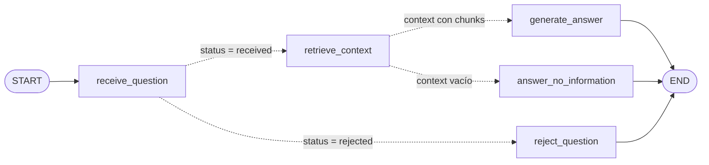

# Agente de soporte con LangGraph, parte 1: migración y flujo del agente

El RAG del Hito 7 (`data/pipelines/rag.py`) funcionaba como una caja negra:
`query(question)` recuperaba y generaba en una sola llamada. Ahora el mismo comportamiento
vive en un **grafo de LangGraph**:
- el estado es explícito y mínimo;
- cada nodo tiene una sola responsabilidad;
- las aristas son condicionales;
- se valida y compila antes de ejecutar;
- hay un checkpoint después de cada nodo;
- cada corrida deja una traza persistente.

La lógica RAG **no se reescribió**: los nodos llaman a `retrieve()` y a
`generate_answer()` del Hito 7.

| Pieza | Archivo |
| --- | --- |
| Estado | [`services/agent/state.py`](../../services/agent/state.py) |
| Nodos | [`services/agent/nodes.py`](../../services/agent/nodes.py) |
| Grafo: aristas, validación y compilación | [`services/agent/graph.py`](../../services/agent/graph.py) |
| Checkpoints, ejecución y reanudación | [`services/agent/runner.py`](../../services/agent/runner.py) |
| Traza persistente | [`services/agent/tracing.py`](../../services/agent/tracing.py) |
| Endpoint | [`services/agent/router.py`](../../services/agent/router.py) (`POST /agent/query`, `GET /agent/runs/{run_id}/trace`) |
| Evals | [`tests/pipelines/test_agent_evals.py`](../../tests/pipelines/test_agent_evals.py), casos en [`data/eval/agent-eval-cases.json`](../../data/eval/agent-eval-cases.json) y trazas en [`data/eval/agent_eval_traces.json`](../../data/eval/agent_eval_traces.json) |
| Tests del grafo y del endpoint | [`tests/pipelines/test_agent_graph.py`](../../tests/pipelines/test_agent_graph.py) y [`services/api/tests/test_agent.py`](../../services/api/tests/test_agent.py) |

## 1. Grafo



| Nodo | Responsabilidad | Llama a | Escribe |
| --- | --- | --- | --- |
| `receive_question` | Normaliza los espacios y decide si la pregunta se puede responder (entre 3 y 1000 caracteres) | — | `question`, `status`, `error` |
| `reject_question` | Termina con un error claro; no recupera ni genera | — | `status`, `error` |
| `retrieve_context` | Busca en `healthcore_knowledge` con el umbral `min_score` = 0,30 | `data.pipelines.rag.retrieve(question)` | `context`, `status` |
| `generate_answer` | Responde con **el contexto que `retrieve_context` ya produjo** | `data.pipelines.rag.generate_answer(question, context)` | `answer`, `status` |
| `answer_no_information` | Respuesta honesta y fija («No tengo información sobre eso…»), sin llamar al modelo sobre un contexto vacío | — | `answer`, `status` |

**Aristas condicionales.** No son una secuencia fija:
- `route_after_receive` lee `status`;
- `route_after_retrieve` lee `context`.

Las dos funciones son puras y se prueban por separado.

**Ningún nodo llama a `query()`.** La recuperación ocurre una sola vez por pregunta y
aparece como su propio paso en la traza. Lo verifican un test (que hace fallar `query()` si
se llama) y los evals (`retrieve_context` aparece como máximo una vez y siempre antes de
`generate_answer`).

`query()` sigue existiendo, sin cambios, para el endpoint RAG `POST /knowledge/query`, que
convive con el agente.

## 2. Estado mínimo

```python
class AgentState(TypedDict, total=False):
    question: str                  # entrada, normalizada por receive_question
    status: Literal["received", "rejected", "retrieved", "no_context", "answered"]
    context: list[RetrievedChunk]  # salida de retrieve_context, entrada de generate_answer
    answer: str                    # respuesta final
    error: str                     # motivo del rechazo
```

**Sin historial de conversación.** Cada pregunta de mostrador se responde por sí misma
desde la base de conocimiento: el RAG no tiene memoria. Arrastrar turnos anteriores solo
agrandaría los checkpoints, y podría mezclar el contexto de un paciente en la pregunta de
otro coordinador (BRIEFING §6, PHI). Si la parte 2 necesita memoria, se añadirá como un
campo justificado.

Los evals comprueban que el estado final solo contiene claves de `AgentState`.

## 3. Compilación y validación estructural

El grafo se construye, se valida y se compila con `compile_agent()`:

- **Al importar** `services.agent.graph` (constante `STRUCTURE`), sin E/S. Si la estructura
  está rota, la API falla al arrancar, no en la primera petición.
- **Al crear el runtime**, otra vez con el checkpointer y el tracer, antes de cualquier
  `invoke`.

El `compile()` de LangGraph detecta aristas hacia nodos inexistentes y la falta de punto de
entrada, pero **acepta nodos huérfanos y nodos sin salida** (lo comprobé con LangGraph
1.2.24). Por eso `validate_structure()` añade estas comprobaciones, que lanzan
`GraphStructureError` con un mensaje claro:

| Error | Mensaje |
| --- | --- |
| Nodo no alcanzable desde START | `Nodes not connected to START: ['orphan']` |
| Nodo sin camino a END | `Nodes with no path to END: ['dead_end']` |
| Arista condicional hacia un nodo no declarado | `Conditional edge from 'receive_question' routes to unknown node 'missing'` |
| Arista condicional sin `path_map` | `Conditional edge from '…' must declare its targets (path_map)` |
| Nodo que escribe claves fuera de `AgentState` (estado mal tipado) | `Node 'generate_answer' writes keys that are not in AgentState: ['chat_history']` |
| Errores propios de LangGraph (nodo inexistente, sin entrada) | Se convierten en `GraphStructureError` |

Cada caso tiene un test en `test_agent_graph.py`.

## 4. Checkpointing

- **Checkpointer:** `SqliteSaver` de LangGraph (`langgraph-checkpoint-sqlite`).
- **Hilos:** uno por corrida, con `thread_id = run_id`.
- **Base de datos:** `AGENT_STATE_DIR/agent.sqlite`. Por defecto es `data/agent_state/`,
  que no se versiona; en Docker es `/data/agent`, en el volumen `api_data`.
- **Cuándo se escribe:** después de **cada nodo**. Una corrida normal deja 5 checkpoints:

  | Paso | Siguiente nodo | `status` |
  | --- | --- | --- |
  | -1 | `__start__` | — |
  | 0 | `receive_question` | — |
  | 1 | `retrieve_context` | `received` |
  | 2 | `generate_answer` | `retrieved` (ya contiene `context`) |
  | 3 | — (final) | `answered` |

**Inspeccionar.** `AgentRuntime.checkpoint_history(run_id)`, incluido en la traza de la API.

**Reanudar.** `AgentRuntime.resume(run_id)` continúa desde el último checkpoint y **no
repite los nodos completados**. El test `test_failed_run_is_traced_and_resumes_from_its_last_checkpoint`
lo comprueba:
1. Hace fallar `generate_answer`; la corrida queda `failed` con el error en la traza.
2. Otro proceso abre la misma base de datos y reanuda.
3. `retrieve()` no se vuelve a llamar y la respuesta se genera con el contexto guardado en
   el checkpoint.

## 5. Traza

**Sin LangSmith.** No hay credenciales, así que uso un log estructurado propio en SQLite,
en el mismo archivo que los checkpoints. Se consulta después de la corrida; no solo se
imprime en consola.

- **`agent_runs`:** una fila por corrida, con pregunta, estado (`answered`, `rejected` o
  `failed`), ruta (`receive_question > retrieve_context > generate_answer`), respuesta,
  error y tiempos.
- **`agent_trace_steps`:** una fila por nodo ejecutado, en orden. Guarda el número de paso,
  el nodo, `ok` o `error`, el inicio, la duración en ms, **qué produjo**
  (`output_json`) y el error si lo hubo.
  - Los chunks recuperados se resumen a documento, índice, sección y similitud; el texto
    no se guarda.

Cada nodo se envuelve en `traced()`, así que la traza se escribe aunque el nodo falle.

**Cómo consultarla:**

```bash
# API (solo administradores: incluye secciones y similitudes, que los coordinadores no ven)
curl -H "Authorization: Bearer $TOKEN" localhost:8000/agent/runs/<run_id>/trace

# SQL directo
sqlite3 data/agent_state/agent.sqlite \
  "select step, node, status, duration_ms from agent_trace_steps where run_id = '<run_id>' order by step"
```

Ejemplo exportado de una corrida real:
[`docs/agent/evidence/trace-run-example.json`](evidence/trace-run-example.json).

| Paso | Nodo | Duración | Produjo |
| --- | --- | --- | --- |
| 1 | `receive_question` | 0 ms | `status: received` |
| 2 | `retrieve_context` | 852 ms | 4 chunks; el primero, `appointment-policy#1` «Política de cancelación» (0,61) |
| 3 | `generate_answer` | 8754 ms | «Sí, por cancelar con 12 horas de anticipación (menos de 24 horas) se aplica un cargo de 50 USD (o 40 GBP en Reino Unido)…» |

## 6. Evals

```bash
python -m services.agent.record_evals          # una corrida real por caso → data/eval/agent_eval_traces.json
python -m pytest tests/pipelines/test_agent_evals.py
```

**Corren contra la traza, no en vivo.** `record_evals` ejecuta cada caso una vez (Qdrant
más el gateway de 4Geeks) y guarda la traza completa. Los evals solo leen esas trazas, así
que corren en el CI sin modelos.

**Los 8 casos** (`agent-eval-cases.json`) cubren los cuatro documentos, una pregunta fuera
de tema y una vacía. Se comprueban 31 criterios:

| Eval | Criterio |
| --- | --- |
| Ruta | Los nodos ejecutados, en orden, son los esperados para cada caso (por ejemplo, la pregunta vacía va a `receive_question > reject_question`) |
| Invariantes de la traza | Todos los pasos `ok` y numerados; `retrieve_context` como máximo una vez y antes de `generate_answer`; generación solo con contexto; un checkpoint por nodo y el último final; estado mínimo |
| Recuperación | El chunk esperado está en el top 3 (por ejemplo, `appointment-policy#1` para la cancelación) |
| **Anclaje en el BRIEFING** | La respuesta contiene los datos de la base de conocimiento: «50 USD», «40 GBP», «Medicare» y «Medicaid» para la cancelación; «Texas» y «Florida» para Medicaid en Georgia; «Marcus Reid» para el escalado de referencias; «Tom Callahan» para Humana, sin confirmar la cobertura; que a Medicare no se le cobra; y siempre una línea `Fuente:` |
| Honestidad | La pregunta fuera de tema no llega a `generate_answer` y responde con el texto fijo de «no tengo información» |
| Rechazo | La pregunta vacía nunca llega a `retrieve_context` |

**Resultado: 31 de 31** ([`data/eval/agent_evals_result.txt`](../../data/eval/agent_evals_result.txt)).
Los tests RAG existentes (`tests/pipelines/test_rag.py`, Recall@3) siguen pasando: estos
evals los amplían, no los sustituyen.

## 7. Endpoint

- **`POST /agent/query`:**
  - Recibe `{"question"}` y responde `{"answer", "run_id"}`. Requiere sesión.
  - Solo llama a `get_runtime().run(question)`: no tiene lógica de negocio propia.
  - **Pregunta rechazada por el grafo:** responde **422** con el mensaje del nodo
    `reject_question`.
  - **Fallo en cualquier nodo:** responde **503** con un mensaje claro y el `run_id`, para
    buscar la traza. Nunca devuelve un stack trace ni detalles internos (URL del gateway,
    excepciones), y un test lo verifica. El detalle queda en el log del servidor.
- **`GET /agent/runs/{run_id}/trace`:** solo para administradores. Devuelve la traza y los
  checkpoints.
- **`POST /knowledge/query`**, el endpoint RAG, sigue funcionando sin cambios.
