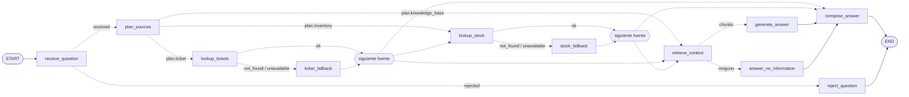

# Agente de soporte con LangGraph (partes 1 y 2)

**Parte 1.** El RAG del Hito 7 (`data/pipelines/rag.py`) funcionaba como una caja negra:
`query(question)` recuperaba y generaba en una sola llamada. Ahora el mismo comportamiento
vive en un **grafo de LangGraph**:
- el estado es explícito y mínimo;
- cada nodo tiene una sola responsabilidad;
- las aristas son condicionales;
- se valida y compila antes de ejecutar;
- hay un checkpoint después de cada nodo;
- cada corrida deja una traza persistente.

La lógica RAG **no se reescribió**: los nodos llaman a `retrieve()` y a
`generate_answer()` del Hito 7.

**Parte 2.** El agente decide por sí mismo si una pregunta necesita la base de
conocimiento, una **tool de datos en vivo** (el gestor de incidentes o el inventario) o
varias fuentes (§8).

| Pieza | Archivo |
| --- | --- |
| Estado | [`services/agent/state.py`](../../services/agent/state.py) |
| Nodos | [`services/agent/nodes.py`](../../services/agent/nodes.py) |
| Planificador de fuentes | [`services/agent/planner.py`](../../services/agent/planner.py) |
| Tools de solo lectura (tickets y stock) | [`services/agent/tools.py`](../../services/agent/tools.py) |
| Grafo: aristas, validación y compilación | [`services/agent/graph.py`](../../services/agent/graph.py) |
| Checkpoints, ejecución y reanudación | [`services/agent/runner.py`](../../services/agent/runner.py) |
| Traza persistente | [`services/agent/tracing.py`](../../services/agent/tracing.py) |
| Endpoint | [`services/agent/router.py`](../../services/agent/router.py) (`POST /agent/query`, `GET /agent/runs/{run_id}/trace`) |
| Evals | [`tests/pipelines/test_agent_evals.py`](../../tests/pipelines/test_agent_evals.py), casos en [`data/eval/agent-eval-cases.json`](../../data/eval/agent-eval-cases.json) y trazas en [`data/eval/agent_eval_traces.json`](../../data/eval/agent_eval_traces.json) |
| Tests | [`tests/pipelines/test_agent_graph.py`](../../tests/pipelines/test_agent_graph.py), [`tests/pipelines/test_agent_tools.py`](../../tests/pipelines/test_agent_tools.py) y [`services/api/tests/test_agent.py`](../../services/api/tests/test_agent.py) |

## 1. Grafo



«Siguiente fuente» no es un nodo: es la función de enrutamiento `next_source`, que se aplica
después de `plan_sources` y de cada tool (o de su fallback). Elige la próxima fuente que el
plan necesita y aún no se consultó, en este orden: tickets, stock y base de conocimiento.
Si no queda ninguna, va a `compose_answer`.

| Nodo | Responsabilidad | Llama a | Escribe |
| --- | --- | --- | --- |
| `receive_question` | Normaliza los espacios y decide si la pregunta se puede responder (entre 3 y 1000 caracteres) | — | `question`, `status`, `error` |
| `reject_question` | Termina con un error claro; no consulta ninguna fuente | — | `status`, `error` |
| `plan_sources` | Decide qué fuentes necesita la pregunta (§8.3) | `planner.plan_sources(question)` | `plan`, `status` |
| `lookup_tickets` | Lee tickets del gestor de incidentes, en vivo | `tools.lookup_tickets(TicketQuery)` → `GET /api/incidents…` | `ticket_result` |
| `ticket_fallback` | Respuesta honesta si la tool falla o el ticket no existe | — | `tool_fallbacks` |
| `lookup_stock` | Lee el stock de un producto del inventario, en vivo | `tools.lookup_stock(StockQuery)` → `GET /inventory/products` | `stock_result` |
| `stock_fallback` | Respuesta honesta si el inventario falla o el producto no existe | — | `tool_fallbacks` |
| `retrieve_context` | Busca en `healthcore_knowledge` con el umbral `min_score` = 0,30 | `data.pipelines.rag.retrieve(question)` | `context`, `status` |
| `generate_answer` | Responde con **el contexto que `retrieve_context` ya produjo** | `data.pipelines.rag.generate_answer(question, context)` | `rag_answer` |
| `answer_no_information` | Respuesta honesta y fija («No tengo información sobre eso…»), sin llamar al modelo sobre un contexto vacío | — | `rag_answer` |
| `compose_answer` | Une las partes en el orden de las fuentes: tools y después RAG | — | `answer`, `status` |

**Aristas condicionales.** No son una secuencia fija:
- `route_after_receive` lee `status`;
- `next_source` lee `plan` y las fuentes que ya corrieron;
- `route_after_tickets` y `route_after_stock` leen el resultado de la tool;
- `route_after_retrieve` lee `context`.

Todas son funciones puras y se prueban por separado.

**Ningún nodo llama a `query()`.** La recuperación ocurre una sola vez por pregunta y
aparece como su propio paso en la traza. Lo verifican un test (que hace fallar `query()` si
se llama) y los evals (cada nodo aparece como máximo una vez, y `retrieve_context` siempre
antes de `generate_answer`).

`query()` sigue existiendo, sin cambios, para el endpoint RAG `POST /knowledge/query`, que
convive con el agente.

## 2. Estado mínimo

```python
class AgentState(TypedDict, total=False):
    question: str                   # entrada, normalizada por receive_question
    status: Literal["received", "rejected", "planned", "retrieved", "no_context", "answered"]
    error: str                      # motivo del rechazo
    plan: dict                      # SourcePlan: qué fuentes necesita la pregunta
    ticket_result: dict             # TicketLookupResult de lookup_tickets
    stock_result: dict              # StockLookupResult de lookup_stock
    tool_fallbacks: Annotated[list[str], operator.add]  # respuestas honestas de tools fallidas
    context: list[RetrievedChunk]   # salida de retrieve_context, entrada de generate_answer
    rag_answer: str                 # parte de la base de conocimiento
    answer: str                     # respuesta final (compose_answer)
```

**Sin historial de conversación.** Cada pregunta de mostrador se responde por sí misma.
Arrastrar turnos anteriores solo agrandaría los checkpoints, y podría mezclar el contexto
de un paciente en la pregunta de otro coordinador (BRIEFING §6, PHI).

**Credenciales fuera del estado.** El token que usan las tools no está en el estado, ni en
los checkpoints, ni en la traza (§8.2).

Los evals comprueban que el estado final solo contiene claves de `AgentState`.

## 3. Compilación y validación estructural

El grafo se construye, se valida y se compila con `compile_agent()`:

- **Al importar** `services.agent.graph` (constante `STRUCTURE`), sin E/S. Si la estructura
  está rota, la API falla al arrancar, no en la primera petición.
- **Al crear el runtime**, otra vez con el checkpointer y el tracer, antes de cualquier
  `invoke`.

El `compile()` de LangGraph detecta aristas hacia nodos inexistentes y la falta de punto de
entrada, pero **acepta nodos huérfanos y nodos sin salida** (lo comprobé con LangGraph
1.2.24). Por eso `validate_structure()` añade estas comprobaciones, que lanzan
`GraphStructureError` con un mensaje claro:

| Error | Mensaje |
| --- | --- |
| Nodo no alcanzable desde START | `Nodes not connected to START: ['orphan']` |
| Nodo sin camino a END | `Nodes with no path to END: ['dead_end']` |
| Arista condicional hacia un nodo no declarado | `Conditional edge from 'receive_question' routes to unknown node 'missing'` |
| Arista condicional sin `path_map` | `Conditional edge from '…' must declare its targets (path_map)` |
| Nodo que escribe claves fuera de `AgentState` (estado mal tipado) | `Node 'generate_answer' writes keys that are not in AgentState: ['chat_history']` |
| Errores propios de LangGraph (nodo inexistente, sin entrada) | Se convierten en `GraphStructureError` |

Cada caso tiene un test en `test_agent_graph.py`.

## 4. Checkpointing

- **Checkpointer:** `SqliteSaver` de LangGraph (`langgraph-checkpoint-sqlite`).
- **Hilos:** uno por corrida, con `thread_id = run_id`.
- **Base de datos:** `AGENT_STATE_DIR/agent.sqlite`. Por defecto es `data/agent_state/`,
  que no se versiona; en Docker es `/data/agent`, en el volumen `api_data`.
- **Cuándo se escribe:** después de **cada nodo**. Una corrida normal deja 5 checkpoints:

  | Paso | Siguiente nodo | `status` |
  | --- | --- | --- |
  | -1 | `__start__` | — |
  | 0 | `receive_question` | — |
  | 1 | `retrieve_context` | `received` |
  | 2 | `generate_answer` | `retrieved` (ya contiene `context`) |
  | 3 | — (final) | `answered` |

**Inspeccionar.** `AgentRuntime.checkpoint_history(run_id)`, incluido en la traza de la API.

**Reanudar.** `AgentRuntime.resume(run_id)` continúa desde el último checkpoint y **no
repite los nodos completados**. El test `test_failed_run_is_traced_and_resumes_from_its_last_checkpoint`
lo comprueba:
1. Hace fallar `generate_answer`; la corrida queda `failed` con el error en la traza.
2. Otro proceso abre la misma base de datos y reanuda.
3. `retrieve()` no se vuelve a llamar y la respuesta se genera con el contexto guardado en
   el checkpoint.

## 5. Traza

**Sin LangSmith.** No hay credenciales, así que uso un log estructurado propio en SQLite,
en el mismo archivo que los checkpoints. Se consulta después de la corrida; no solo se
imprime en consola.

- **`agent_runs`:** una fila por corrida, con pregunta, estado (`answered`, `rejected` o
  `failed`), ruta (`receive_question > retrieve_context > generate_answer`), respuesta,
  error y tiempos.
- **`agent_trace_steps`:** una fila por nodo ejecutado, en orden. Guarda el número de paso,
  el nodo, `ok` o `error`, el inicio, la duración en ms, **qué produjo**
  (`output_json`) y el error si lo hubo.
  - Los chunks recuperados se resumen a documento, índice, sección y similitud; el texto
    no se guarda.

Cada nodo se envuelve en `traced()`, así que la traza se escribe aunque el nodo falle.

**Cómo consultarla:**

```bash
# API (solo administradores: incluye secciones y similitudes, que los coordinadores no ven)
curl -H "Authorization: Bearer $TOKEN" localhost:8000/agent/runs/<run_id>/trace

# SQL directo
sqlite3 data/agent_state/agent.sqlite \
  "select step, node, status, duration_ms from agent_trace_steps where run_id = '<run_id>' order by step"
```

Ejemplo exportado de una corrida real de la parte 1, anterior a `plan_sources`:
[`docs/agent/evidence/trace-run-example.json`](evidence/trace-run-example.json). Los de la parte 2 están en §8.5.

| Paso | Nodo | Duración | Produjo |
| --- | --- | --- | --- |
| 1 | `receive_question` | 0 ms | `status: received` |
| 2 | `retrieve_context` | 852 ms | 4 chunks; el primero, `appointment-policy#1` «Política de cancelación» (0,61) |
| 3 | `generate_answer` | 8754 ms | «Sí, por cancelar con 12 horas de anticipación (menos de 24 horas) se aplica un cargo de 50 USD (o 40 GBP en Reino Unido)…» |

## 6. Evals

```bash
python -m services.agent.record_evals          # una corrida real por caso → data/eval/agent_eval_traces.json
python -m pytest tests/pipelines/test_agent_evals.py
```

**Corren contra la traza, no en vivo.** `record_evals` ejecuta cada caso una vez (Qdrant
más el gateway de 4Geeks) y guarda la traza completa. Los evals solo leen esas trazas, así
que corren en el CI sin modelos.

**Los 8 casos** (`agent-eval-cases.json`) cubren los cuatro documentos, una pregunta fuera
de tema y una vacía. Se comprueban 31 criterios:

| Eval | Criterio |
| --- | --- |
| Ruta | Los nodos ejecutados, en orden, son los esperados para cada caso (por ejemplo, la pregunta vacía va a `receive_question > reject_question`) |
| Invariantes de la traza | Todos los pasos `ok` y numerados; `retrieve_context` como máximo una vez y antes de `generate_answer`; generación solo con contexto; un checkpoint por nodo y el último final; estado mínimo |
| Recuperación | El chunk esperado está en el top 3 (por ejemplo, `appointment-policy#1` para la cancelación) |
| **Anclaje en el BRIEFING** | La respuesta contiene los datos de la base de conocimiento: «50 USD», «40 GBP», «Medicare» y «Medicaid» para la cancelación; «Texas» y «Florida» para Medicaid en Georgia; «Marcus Reid» para el escalado de referencias; «Tom Callahan» para Humana, sin confirmar la cobertura; que a Medicare no se le cobra; y siempre una línea `Fuente:` |
| Honestidad | La pregunta fuera de tema no llega a `generate_answer` y responde con el texto fijo de «no tengo información» |
| Rechazo | La pregunta vacía nunca llega a `retrieve_context` |

**Resultado en la parte 1: 31 de 31.** Con la parte 2 son 16 casos y 93 de 93 (§8.5,
[`data/eval/agent_evals_result.txt`](../../data/eval/agent_evals_result.txt)).
Los tests RAG existentes (`tests/pipelines/test_rag.py`, Recall@3) siguen pasando: estos
evals los amplían, no los sustituyen.

## 7. Endpoint

- **`POST /agent/query`:**
  - Recibe `{"question"}` y responde `{"answer", "run_id"}`. Requiere sesión.
  - Solo llama a `get_runtime().run(question)`: no tiene lógica de negocio propia.
  - **Pregunta rechazada por el grafo:** responde **422** con el mensaje del nodo
    `reject_question`.
  - **Fallo en cualquier nodo:** responde **503** con un mensaje claro y el `run_id`, para
    buscar la traza. Nunca devuelve un stack trace ni detalles internos (URL del gateway,
    excepciones), y un test lo verifica. El detalle queda en el log del servidor.
- **`GET /agent/runs/{run_id}/trace`:** solo para administradores. Devuelve la traza y los
  checkpoints.
- **`POST /knowledge/query`**, el endpoint RAG, sigue funcionando sin cambios.

## 8. Parte 2: tools fuera del RAG

**El problema.** El RAG responde bien sobre políticas, pero «¿en qué estado está el ticket
482?» no está en la base de conocimiento: está en el gestor de incidentes, y cambia todo el
tiempo. Indexar los tickets en Qdrant daría un dato desactualizado en cuanto alguien cambie
su estado.

**La solución.** El agente consulta esos **datos operativos en vivo** con tools de solo
lectura, y deja el RAG para el **conocimiento estable**.

### 8.1 Tools: contrato tipado, solo lectura y timeout

Cada tool tiene una sola responsabilidad: tickets en una, inventario en otra.

| Tool | Entrada | Salida | Servicio real |
| --- | --- | --- | --- |
| `lookup_tickets` | `TicketQuery`: `ticket_id`, o filtros `status`, `category`, `origin`, `branch` (valores del catálogo `packages/shared/incidents`) | `TicketLookupResult`: `status` (`ok`/`not_found`/`unavailable`), `tickets` con `id`, `title`, `status`, `category`, `origin`, `branch`, `created_at` y `updated_at`; además `total`, `endpoint`, `duration_ms` y `error` | `GET /api/incidents/{id}` o `GET /api/incidents?status=&category=&origin=&branch=` del gestor de incidentes (PR #6, integrado en esta rama) |
| `lookup_stock` | `StockQuery`: `product` (nombre o SKU, de 2 a 80 caracteres) | `StockLookupResult`: `status`, `products` con `name`, `sku`, `country`, `unit` y `current_stock`; además `endpoint`, `duration_ms` y `error` | `GET /inventory/products` del gestor de inventario |

- **Sin datos simulados.** Las tools llaman por HTTP a la API real (`AGENT_TOOLS_API_URL`,
  por defecto `http://127.0.0.1:8000`). Los 94 incidentes y los 10 productos son los de la
  base de datos del monorepo.
- **Solo lectura.** Solo emiten `GET`; ninguna crea, actualiza ni borra datos. Un test
  levanta un servidor HTTP y comprueba que solo recibe `GET`.
- **Sin texto libre del paciente.** La tool de tickets no devuelve la `description`, que
  podría contenerlo.
- **Coincidencia de productos.** Se busca por SKU exacto o por las palabras del nombre,
  ignorando tildes, mayúsculas y plurales: «vacunas antigripales» encuentra «Vacuna
  antigripal (dosis)».
- **Timeout explícito: `TOOL_TIMEOUT_SECONDS = 4.0`** por llamada (conexión y lectura),
  configurable con `AGENT_TOOL_TIMEOUT_SECONDS`. El grafo nunca queda colgado: en el eval
  `ticket-timeout`, la tool falla a los 4,0 s y la corrida termina con una respuesta honesta.

### 8.2 Autenticación

`/api/incidents` y `/inventory/products` exigen un Bearer JWT.
- **Mismo token que el coordinador.** Las tools reenvían el token del coordinador que
  preguntó, igual que hace el backoffice con la API. Así el agente nunca ve más de lo que
  el coordinador puede ver.
- **Sin persistencia.** El endpoint pasa el token a una `ContextVar` que solo existe
  durante esa corrida; nunca entra al estado, a los checkpoints ni a la traza (hay un test
  que lo comprueba).
- **Para grabar los evals** se inicia sesión con `AGENT_EVAL_USERNAME` y
  `AGENT_EVAL_PASSWORD` desde el entorno. No hay ningún token en el código ni en el
  repositorio.

**Corrección necesaria: el lock de TinyDB.** La dependencia `CurrentUser` mantenía tomado
el lock global de TinyDB, la base de usuarios, durante **toda** la petición. Por eso
`/agent/query`, al llamar a `/api/incidents` en la misma API, no podía autenticar esa
llamada hasta que expiraba el timeout.
- **Arreglo:** `AuthenticatedUser` (`services/api/core/dependencies.py`) suelta el lock en
  cuanto valida el token. Lo usan los endpoints largos que no vuelven a tocar TinyDB:
  `/agent/query` y `/knowledge/query`.
- **Efecto secundario:** el RAG ya no bloquea al resto de la API mientras genera.
- **Resultado:** la tool de tickets pasó de 4010 ms (timeout) a entre 17 y 94 ms. Hay un
  test de regresión.

### 8.3 Enrutamiento: el agente decide

El coordinador nunca dice qué fuente usar. El nodo `plan_sources` decide:

1. **El modelo de generación devuelve un plan JSON** (`SourcePlan`), sin responder la
   pregunta. El plan se valida contra los contratos de las tools y el catálogo de
   incidentes:
   - un `ticket_id` que no está escrito en la pregunta se rechaza, para que no pueda
     inventarse un ticket;
   - un valor fuera del catálogo se rechaza.
2. **Si el modelo falla o el plan no es válido**, deciden reglas deterministas (número de
   ticket, palabras de stock, palabras de política). La traza registra qué planificador
   decidió y por qué (`plan.planner` y `plan.note`).
3. **Preguntas mixtas.** El plan incluye `knowledge_question`: solo la parte de política,
   como pregunta independiente. El RAG responde la política, no el caso del ticket ni del
   paciente.
   - **Por qué.** Sin esto, en la primera grabación el RAG recibió la historia del ticket y
     dedujo una excepción que no existe («no aplicaría un cargo… no es responsabilidad del
     paciente»). Lo detectó el eval de anclaje, y ahora hay un criterio que lo prohíbe.

| Pregunta (sin indicar fuente) | Plan | Ruta |
| --- | --- | --- |
| «¿En qué estado está el ticket 2?» | `ticket: {ticket_id: 2}` | `plan_sources > lookup_tickets > compose_answer` |
| «¿Qué tickets abiertos hay en London West?» | `ticket: {status: open, branch: london_west}` | igual |
| «¿Tenemos stock de guantes de nitrilo?» | `inventory: {product: guantes de nitrilo}` | `plan_sources > lookup_stock > compose_answer` |
| «¿Cobran cargo por cancelación con 12 horas…?» | `knowledge_base` | `plan_sources > retrieve_context > generate_answer > compose_answer` |
| «El ticket 2 es de un paciente al que no avisaron…: ¿estado y política de cancelación?» | `ticket` + `knowledge_base` (`knowledge_question`: «¿qué dice la política de cancelación?») | `lookup_tickets > retrieve_context > generate_answer > compose_answer` |

### 8.4 Fallback: nunca inventar un estado

Si una tool agota el timeout, el servicio no responde, devuelve un 5xx o un 401, o el
recurso no existe, devuelve `unavailable` o `not_found` **sin lanzar una excepción**. La
arista condicional lleva entonces a su nodo de fallback (`ticket_fallback` o
`stock_fallback`), que responde con honestidad:

- «No pude confirmar el estado del ticket #2 ahora mismo: el gestor de incidentes no
  respondió. Inténtalo de nuevo en unos minutos o revísalo en la sección Incidentes del
  backoffice.»
- «No encontré el ticket #99999 en el gestor de incidentes. Revisa el número: no puedo
  confirmar su estado.»
- «No encontré «desfibriladores» en el inventario de HealthCore, así que no puedo confirmar
  si hay stock.»

La corrida no se rompe. Si la pregunta también pedía una política, el RAG la responde
igualmente.

**Las respuestas de las tools no pasan por el modelo.** `compose_answer` formatea los datos
tal cual los devolvió el servicio, con su línea `Fuente:` (endpoint y hora de la consulta).
El estado o el stock que se muestra es exactamente el del sistema.

### 8.5 Traza y evals (ampliados)

**La traza** (`agent_runs.sources`) dice qué fuentes se usaron y en qué orden:
- `incidents`
- `inventory`
- `knowledge_base`
- `incidents > knowledge_base`

Cada paso guarda además el plan y el resultado de la tool: estado, endpoint, duración y
error.

**Exports de corridas reales por la API:**

| Archivo | Fuentes | Ruta |
| --- | --- | --- |
| [`trace-ticket-tool.json`](evidence/trace-ticket-tool.json) | `incidents` | `receive_question > plan_sources > lookup_tickets > compose_answer` |
| [`trace-rag.json`](evidence/trace-rag.json) | `knowledge_base` | `receive_question > plan_sources > retrieve_context > generate_answer > compose_answer` |
| [`trace-ticket-and-rag.json`](evidence/trace-ticket-and-rag.json) | `incidents > knowledge_base` | — |
| [`trace-stock-tool.json`](evidence/trace-stock-tool.json) | `inventory` | — |

**Evals: 16 casos** (los 8 de la parte 1 más 8 nuevos), grabados contra los servicios
reales. Para los casos con fallo inyectado, `record_evals` apunta las tools a un servidor
que acepta conexiones y nunca responde (`timeout`) o a un puerto cerrado (`down`).
**Resultado: 93 de 93** ([`data/eval/agent_evals_result.txt`](../../data/eval/agent_evals_result.txt)).

| Eval nuevo | Criterio |
| --- | --- |
| Pregunta de tickets → tool, no RAG | `lookup_tickets` se ejecuta y ningún nodo RAG lo hace (`ticket-status`, `ticket-list`, `ticket-not-found`, `ticket-timeout`, `ticket-service-down`) |
| Pregunta de stock → tool de inventario, no RAG | `stock-gloves`, `stock-unknown-product` |
| Pregunta de política → RAG, no tool | Los 7 casos RAG: plan sin `ticket` ni `inventory`, y ningún nodo de tool |
| Mixta → tool y después RAG | `ticket-and-policy`: `lookup_tickets` antes de `retrieve_context`, y la política sin la excepción inventada |
| Fuentes en la traza | `sources` coincide con lo esperado en los 16 casos |
| Fallback | `ticket-timeout` (4 s reales), `ticket-service-down` (`ConnectError`), `ticket-not-found` (404) y `stock-unknown-product`: nodo de fallback, respuesta honesta y ningún estado ni stock inventado |
| Respuesta = datos del servicio | Número, estado y total del ticket, y stock del producto, tal cual los devolvió la tool |

```bash
AGENT_EVAL_USERNAME=... AGENT_EVAL_PASSWORD=... python -m services.agent.record_evals   # con la API levantada
python -m pytest tests/pipelines/test_agent_evals.py
```

## 9. Migración a MCP: las tools ya no llaman a las APIs

Desde esta rama, `lookup_tickets` y `lookup_stock` **no llaman al Incidents Manager ni al
inventario por HTTP directo**. Las tools se cargan del servidor MCP
[`mcps/healthcore_mcp`](../../mcps/healthcore_mcp/README.md) con `langchain-mcp-adapters` y se
llaman como cliente MCP:

| Nodo del grafo | Antes (parte 2) | Ahora |
| --- | --- | --- |
| `lookup_tickets` | `GET /api/incidents/{id}` o `GET /api/incidents?…` con el JWT del coordinador | Tool MCP `get_incident` o `list_incidents` |
| `lookup_stock` | `GET /inventory/products` con el JWT del coordinador | Tool MCP `query_inventory(operation="get")` |

- **Cliente MCP.** `services/agent/tools.py` crea `MultiServerMCPClient({"healthcore":
  {"transport": "streamable_http", "url": MCP_SERVER_URL, "headers": {"Authorization":
  "Bearer …"}}})`, descubre las tools (`get_tools()`) y las invoca con un `ToolCall`.
  - **Datos tipados.** El agente lee el resultado de `artifact.structured_content`.
  - **Errores.** Los toma del código JSON del servidor: `NOT_FOUND` da `not_found`, y el resto
    `unavailable`.
- **Credencial.** El agente es el cliente OAuth `healthcore-agent` (client credentials, con el
  token en caché hasta 30 s antes de expirar). Solo tiene `incidents:read` e `inventory:read`:
  aunque tuviera un bug, no podría crear ni cambiar tickets, porque Keycloak no le emite
  `incidents:write` y el servidor devuelve `INSUFFICIENT_SCOPE`.
- **Lo que se eliminó** de la parte 2:
  - la llamada HTTP directa (`_get`, `AGENT_TOOLS_API_URL`);
  - el reenvío del token del coordinador (`tool_credentials`);
  - la búsqueda de productos, que ahora vive en el servidor MCP.

  El test `test_the_agent_has_no_direct_path_to_the_incidents_manager` falla si algún módulo
  del agente vuelve a referenciar `/api/incidents`.
- **Timeout:** 4 s para toda la consulta (token, discovery y llamada).
- **Fallbacks.** El servidor MCP caído o colgado (`MCP_UNREACHABLE`, `TIMEOUT`), un ticket
  inexistente o un scope rechazado llevan a los mismos nodos de fallback.
- **Enrutamiento intacto.** Las 16 rutas de los evals son idénticas a las de la parte 2. Un
  eval nuevo exige que todo dato de tickets o stock venga de una tool MCP (`endpoint`
  `MCP get_incident`, `MCP list_incidents` o `MCP query_inventory`).
- **Resultado:** 101 evals en verde.
- **Exports reales por la API:**
  - [`trace-mcp-ticket-tool.json`](evidence/trace-mcp-ticket-tool.json), con `MCP get_incident` en 268 ms;
  - [`trace-mcp-stock-tool.json`](evidence/trace-mcp-stock-tool.json);
  - [`trace-mcp-rag.json`](evidence/trace-mcp-rag.json).

## 10. Memoria (Hito 8, parte 1)

El grafo suma cuatro nodos: `refuse_phi`, `resolve_pending_proposal`, `recall_memories` y
`self_evaluate`. Con ellos, el agente propone recordar lo que el usuario le enseña y solo lo
guarda con su aprobación explícita. Diseño completo, decisiones y evidencia:
[`memory/memory-design.md`](memory/memory-design.md).

