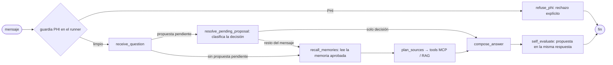

# Memoria y auto-mejora del agente: Hito 8, parte 1

El agente de soporte de HealthCore (grafo LangGraph que consulta la base de conocimiento y el
servidor MCP) ahora **aprende de las conversaciones** sin inventar ni acumular basura:
1. Detecta en cada turno si el usuario le dijo algo que vale la pena recordar.
2. **Se lo propone en la misma respuesta.**
3. Clasifica explícitamente la decisión del usuario en el turno siguiente.
4. Solo guarda lo aprobado, y deja registro de quién lo aprobó.

**Lo que no cambió:** es el mismo agente, con cuatro nodos nuevos y ningún grafo ni agente
adicional. La base de conocimiento sigue siendo de solo lectura.

| Pieza | Archivo |
| --- | --- |
| Guardia de PHI (HIPAA + UK GDPR) | [`services/agent/memory/phi_guard.py`](../../../services/agent/memory/phi_guard.py) |
| Almacén: lectura y escritura explícitas, propuestas, auditoría y consolidación | [`services/agent/memory/store.py`](../../../services/agent/memory/store.py) |
| Auto-evaluación y clasificador de decisión (salida estructurada) | [`services/agent/memory/llm.py`](../../../services/agent/memory/llm.py) |
| Nodos del grafo (`refuse_phi`, `resolve_pending_proposal`, `recall_memories`, `self_evaluate`) | [`services/agent/nodes.py`](../../../services/agent/nodes.py) y [`graph.py`](../../../services/agent/graph.py) |
| CLI de auditoría y consolidación | `python -m services.agent.memory list \| proposals \| audit \| consolidate` |
| Endpoint de auditoría (administradores) | `GET /agent/memory` |
| Evidencia grabada contra el agente real | [`evidence/memory-cycles.md`](evidence/memory-cycles.md) y [`.json`](evidence/memory-cycles.json) |
| Tests | [`tests/pipelines/test_agent_memory.py`](../../../tests/pipelines/test_agent_memory.py) (49) y [`test_agent_memory_evidence.py`](../../../tests/pipelines/test_agent_memory_evidence.py) (12) |

## 1. Flujo

1. **Lectura explícita.** `recall_memories` llama a `MemoryStore.recall(pregunta)`, que
   devuelve como máximo 3 memorias aprobadas con similitud ≥ 0,5. Llegan a la generación como
   bloques de contexto citables («Memoria del agente — aprobada por priya.nair el …»), nunca
   como texto acumulado en el system prompt.
2. **Auto-evaluación.** `self_evaluate` hace **una** llamada estructurada (JSON validado con
   Pydantic): `memorable`, `kind`, `content`, alcance (`scope_clinic`, `scope_country`,
   `scope_staff`), `reason` y `patient_data_requested`.
   - Si propone, el agente añade al final de su respuesta: «¿Quieres que recuerde esto para la
     próxima vez? Propuesta de memoria: «…»».
   - La propuesta queda **pendiente** en `memory_proposals`. No se escribe memoria.
3. **Decisión en el turno siguiente.** Con una propuesta pendiente, el mensaje se clasifica
   **primero** contra ella (`resolve_pending_proposal`). Solo `approve` y `edit` escriben
   memoria, con `approved_by` = el usuario autenticado. Lo que quede del mensaje sigue su curso
   normal.

## 2. Arquitectura de memoria elegida

**Qué necesita recordar el agente** (BRIEFING): pocas decenas de hechos operativos, cortos y
estables, con un alcance claro (una clínica, un país o un miembro del staff). Las consultas
son preguntas en lenguaje natural, como «¿cómo funciona el proceso de referidos en
Manchester?».

| Opción | Decisión | Por qué |
| --- | --- | --- |
| **Memoria semántica en un almacén propio (SQLite + embeddings)** | **Elegida** | Recuperación por similitud (el usuario no repite las palabras exactas) con el **mismo `embed()`** del RAG. Además, en el mismo almacén: transacciones, el índice único de una propuesta pendiente y el registro de auditoría. Con un tope de 200 memorias, la similitud coseno en Python es instantánea y no hace falta otro servicio. El archivo `agent_memory.sqlite` vive junto a los checkpoints del agente (`AGENT_STATE_DIR`, en el volumen persistente `api_data` en Docker). |
| VectorDB (otra colección de Qdrant) | Descartada | Con este volumen no aporta nada que la similitud en proceso no dé. Además añadiría el riesgo de escribir cerca de la colección `healthcore_knowledge`, que el enunciado prohíbe mezclar. |
| Redis / episódica clave-valor | Descartada como almacén principal | Una clave no recupera por significado. Y la auditoría (quién aprobó, cuándo, qué se rechazó) necesita consultas e integridad que un KV no da. |
| Knowledge graph | Descartado | Las relaciones son triviales (hecho → clínica, país o persona) y basta un campo de alcance. Ninguna consulta necesita recorrer dependencias o jerarquías. |
| Fine-tuning | Descartado | No permite olvidar selectivamente: incumpliría la caducidad, la cancelación y la re-verificación de PHI. |

**Separada del RAG.** La base de conocimiento (`healthcore_knowledge` en Qdrant) **no se
toca**. Un test comprueba que el código de `services/agent/memory/` no nombra esa colección ni
importa un cliente de Qdrant. Si una memoria contradice un documento, prevalece el documento:
hay una regla 9 en el prompt de generación y una barrera determinista (§6).

**Umbral de lectura (0,5), medido con los embeddings reales:**

| Pregunta | Similitud |
| --- | --- |
| Pregunta relevante contra su memoria | **0,68 a 0,85** |
| «¿Qué debo traer a mi primera cita?», «¿Aceptan Medicaid en Georgia?», ticket, cancelación | ≤ 0,18 |
| «¿Cómo funciona una referencia interna en Texas?» contra la memoria de Manchester | 0,42: mismo tema, otra clínica, y no debe aplicarse |

**Preferencias de staff.** Solo se recuperan para esa persona, o cuando la pregunta la nombra.

## 3. Qué nunca entra en la memoria (HIPAA + UK GDPR, sin excepciones)

**Prohibido** (BRIEFING): cualquier identificador de paciente y cualquier contenido clínico,
aunque el usuario pida recordarlo. `phi_guard.find_phi()` cubre los dos marcos a la vez:

| Categoría | HIPAA (EE. UU., Safe Harbor 45 CFR 164.514(b)(2)) | UK GDPR (Reino Unido) |
| --- | --- | --- |
| Nombre de un paciente («el paciente Johnson», «Patient Smith», «Sra. García») | Nombres | Dato personal identificable |
| MRN / historia clínica, SSN, número de seguro o afiliado, identificadores largos | Números de historia, de seguridad social, de plan de salud y de cuenta | Identificador directo |
| Número del NHS (10 dígitos), National Insurance, código postal | — | Identificadores nacionales y de localización |
| Teléfono, email, URL, IP | Identificadores de contacto y de red | Dato personal |
| Fecha de nacimiento y fechas de ingreso, alta o fallecimiento | Fechas ligadas a la persona | Dato personal |
| Diagnóstico, código CIE, resultado de laboratorio, nota clínica, alergia o embarazo | PHI (información de salud ligada a una persona) | **Categoría especial (art. 9)** |

**Dónde se aplica** (el BRIEFING pide validar antes de mostrar y también al consolidar):

1. **Antes del grafo** (`AgentRuntime.screen`). Si el mensaje tiene posible PHI, el grafo solo
   recibe `[mensaje redactado: posible PHI (categorías)]` y el nodo `refuse_phi` responde con
   un **rechazo explícito y explicado**, como pide el BRIEFING para «El paciente Johnson canceló
   su cita…». Así el texto nunca llega al estado, a los checkpoints, a la traza, a las
   propuestas ni a la auditoría. Hay un test que recorre el SQLite completo buscando el nombre.
2. **En la auto-evaluación.** Si el modelo marca `patient_data_requested`, o el contenido
   propuesto tiene PHI, la propuesta se bloquea y se explica.
3. **En una edición.** Si la corrección del usuario introduce PHI, termina como
   `blocked_phi` y no se escribe.
4. **En cada escritura y en cada consolidación.** Se re-verifica todo: una memoria que
   tropiece se archiva como `phi_recheck`.

**En la auditoría** solo quedan las categorías detectadas, nunca el contenido
(`redact_for_audit`).

**Trade-off.** La guardia es conservadora a propósito. Un falso positivo solo significa que
el agente no recordará ese mensaje; un falso negativo sería un incumplimiento. Expresiones de
política como «los pacientes de Medicare» o «patient experience» no la activan, porque no
identifican a nadie.

## 4. Qué sí se recuerda y cuándo propone el agente

**Criterio explícito** (prompt de `SELF_EVALUATION_PROMPT`, más controles deterministas). Solo
se propone si **el mensaje del usuario** afirma un hecho **nuevo o corregido** de uno de los
tres tipos del BRIEFING:
- `clinic_correction`: horarios, protocolos locales, excepciones administrativas US/UK;
- `incident_pattern`: patrones de incidentes y su causa, sin datos de paciente;
- `staff_preference`: cómo un miembro del staff quiere la información operativa.

**Nunca se propone** con:
- consultas puntuales o datos en vivo (dashboards, tickets, stock);
- saludos y cierres;
- lo que ya está en memoria o en la base de conocimiento;
- cambios de políticas documentadas;
- hechos que el usuario no afirmó.

**Debe proponer** (los 3 ejemplos del BRIEFING y otros, con evidencia grabada):

| Mensaje | Resultado |
| --- | --- |
| «En la clínica de Manchester el proceso de referidos internos ahora pasa primero por el coordinador…» | `clinic_correction` → aprobada |
| «Esa alerta de no-show elevado en la clínica de Austin fue porque hubo un cierre de carretera…» | `incident_pattern` → rechazada (ciclo 2) |
| «El reporte semanal para Diane Foster debe incluir vacantes por rol…» | `staff_preference` → aprobada con edición |
| «El sistema de referidos falla los lunes en la mañana por el batch nocturno.» | `incident_pattern` (la descarta un cambio de tema) |
| «La clínica de Dallas Uptown abre a las 7:30 los sábados…» | `clinic_correction` (la descarta una respuesta ambigua) |

**No debe proponer** (≥ 3, todos con evidencia):

| Mensaje | Por qué no |
| --- | --- |
| «¿Cuál es la tasa de no-show de esta semana?» | Consulta puntual: el dato vive en el dashboard |
| «El paciente Johnson canceló su cita de mañana, apúntalo.» | **PHI**: rechazo explícito y explicado, no un silencio |
| «Gracias, con eso resuelvo mi reporte.» | Cierre de conversación |
| «¿En qué estado está el ticket 2?» | Dato en vivo del Incidents Manager (vía MCP) |
| «Corrección: … ya acepta el seguro Humana…» / «… a Medicare ahora sí se le cobra…» | Cambio de una política documentada (§6) |

## 5. Propuesta → decisión → registro

- **Clasificación explícita** (`classify_decision`). Una llamada estructurada etiqueta el
  mensaje contra la propuesta: `approve`, `reject`, `edit` (con `edited_content`),
  `unrelated` o `ambiguous`, con `confidence`, `evidence` (el fragmento literal) y
  `remaining_question`. No es un match de «sí»: «Sí, pero que diga…» es `edit`, y «Sí,
  guárdalo. Y otra cosa: ¿…?» es `approve` más una pregunta.
- **Nunca se aprueba por defecto:**
  - Una confianza menor que **0,8**, o una `evidence` que **no aparece literalmente** en el
    mensaje, convierte la etiqueta en `ambiguous` y la propuesta se descarta
    (`discarded_ambiguous`). Por ejemplo, «ok, gracias» → 0,6 → descartada.
  - **Si el clasificador falla**, la propuesta también se descarta; no hay un respaldo por
    palabras clave que pueda aprobar.
  - **Cambio de tema** (`unrelated`): se descarta (`discarded_topic_change`) y el mensaje
    completo se responde como pregunta nueva.
  - **Si el usuario nunca responde**, la propuesta caduca a las **24 h** (`expired`).
- **Una sola pendiente.** Hay un índice único parcial en SQLite
  (`conversation_id where status = 'pending'`), y además `self_evaluate` no propone si ya hay
  una. Como la pendiente se resuelve al principio de cada turno, nunca se acumulan.
- **Registro auditable.** Para cada propuesta, `memory_proposals` guarda:
  - **qué se propuso:** tipo, alcance, contenido y motivo;
  - **a quién y desde qué mensaje:** `proposed_to` y `source_message`, redactado si tuviera PHI;
  - **qué se decidió y cómo:** estado, etiqueta, confianza, clasificador y mensaje de decisión;
  - **quién y cuándo:** `decided_by`, `created_at` y `resolved_at`;
  - **la memoria escrita**, si la hubo.

  `memory_events` es un registro que solo crece: `proposed`, `approved`, `rejected`,
  `discarded_*`, `expired`, `blocked_phi`, `memory_written`, `superseded` y `archived`. Toda
  memoria guarda `approved_by` y `source_proposal_id`: no hay escritura sin un responsable.

## 6. Anti-envenenamiento («correcciones» falsas)

1. **Nada se escribe sin la aprobación explícita** de un usuario autenticado, y se registra
   quién fue.
2. **Las políticas documentadas no son memorizables.** Si el contenido toca seguros o
   aseguradoras, coberturas, Medicare, Medicaid o NHS, tarifas, cargos, cupos o precios, la
   propuesta se descarta aunque el modelo la haya hecho
   (`touches_documented_policy`, determinista). Esas políticas las cambia el dueño del
   documento.
3. **Anclaje.** Al menos el 60 % de las palabras de la propuesta deben venir del mensaje del
   usuario: el modelo no puede añadir hechos.
4. **El documento prevalece al responder.** Si una memoria contradice un documento, gana el
   documento y la respuesta menciona la discrepancia (regla 9 del prompt de generación).
5. **Procedencia visible.** Las memorias se citan como «Memoria del agente — aprobada por X el
   …», nunca como política oficial.
6. **Se puede auditar y revertir.** Con `GET /agent/memory` y la CLI se ve todo; una memoria
   archivada deja de recuperarse.

**Evidencia:** «ya aceptamos Humana…» y «a Medicare ahora sí se le cobra…» no generan
propuesta, y la respuesta cita la política documentada.

## 7. Consolidación y limpieza: cómo olvida el agente

`MemoryStore.consolidate()` se ejecuta tras cada escritura y bajo demanda
(`python -m services.agent.memory consolidate`; se puede programar como job nocturno):

| Regla | Valor | Por qué |
| --- | --- | --- |
| Re-verificación de PHI en todas las memorias activas | Siempre | Lo exige el BRIEFING; además protege de datos viejos o de cambios en la guardia |
| Caducidad por falta de uso (`last_used_at`) | Patrones de incidentes 90 días · correcciones de clínica 180 · preferencias 365 | Un patrón de incidentes envejece rápido (el batch se arregla); una preferencia es estable. Usar una memoria la renueva |
| Deduplicación | Mismo tipo y alcance con similitud ≥ 0,92: la nueva sustituye a la anterior (`superseded`) | Una corrección de un hecho no debe convivir con su versión vieja |
| Tope de capacidad | 200 activas; se archivan las menos usadas recientemente | La memoria nunca crece sin límite |
| Propuestas sin respuesta | Caducan a las 24 h | El silencio nunca aprueba |

**Nada se borra físicamente.** Archivar o sustituir deja rastro en `memory_events`, y el
registro de auditoría se conserva.

## 8. Por qué no hace falta multi-agente

La auto-evaluación es **un nodo más del mismo grafo** (`self_evaluate`), con una llamada
estructurada que recibe el mensaje, la respuesta ya compuesta y las memorias usadas. La
decisión del usuario es otro nodo (`resolve_pending_proposal`), con otra llamada estructurada.
- **Sin estado compartido que coordinar:** la propuesta pendiente vive en el almacén y la lee
  el siguiente turno.
- **Sin negociación entre agentes:** el usuario es quien decide.
- **Sin paralelismo:** cada paso depende del anterior.

Un segundo agente solo añadiría latencia, otro prompt que mantener y otra superficie para
alucinar. Las reglas críticas (PHI, políticas documentadas, anclaje, umbral y evidencia de la
decisión) son código determinista, no la opinión de otro modelo.

**Por qué no va en la misma llamada que la respuesta.** La generación de la respuesta RAG es la
de los hitos anteriores y la comparte `POST /knowledge/query`. Separar la auto-evaluación en su
propio nodo deja intacto ese contrato y funciona igual cuando la respuesta viene de una tool o
del texto fijo de «no tengo información». En esas dos rutas, `self_evaluate` es la única
llamada al modelo.

## 9. Evidencia

[`evidence/memory-cycles.md`](evidence/memory-cycles.md) se grabó contra el agente real, con
un almacén vacío, mediante `python -m services.agent.memory.record_evidence`.

- **Ciclo 1, aprobado.**
  1. `priya.nair` cuenta el cambio de Manchester y el agente propone recordarlo.
  2. «Sí, recuérdalo.» → `approve` (0,95) → memoria escrita, con `approved_by=priya.nair`.
  3. En **otra conversación**, `marcus.reid` pregunta cómo funciona el proceso de referidos en
     Manchester. La respuesta incluye la variante local y cita «Memoria del agente — aprobada
     por priya.nair».
- **Ciclo 2, rechazado.**
  1. La alerta de Austin genera una propuesta.
  2. «No, mejor no lo guardes.» → `reject` (1,0): **la memoria sigue con las mismas entradas**.
  3. La pregunta posterior sobre Austin no recupera nada.

  El registro conserva `proposed → rejected`.
- **Además:**
  - las 4 interacciones no memorables, incluida la de PHI rechazada;
  - una edición (`approved_edited`), una respuesta ambigua (`discarded_ambiguous`) y un cambio
    de tema (`discarded_topic_change`);
  - aprobar y preguntar en el mismo mensaje;
  - 2 intentos de envenenamiento.

  `tests/pipelines/test_agent_memory_evidence.py` verifica todo esto sobre la grabación.

## 10. Límites conocidos

- **La guardia de PHI es heurística** (expresiones regulares): no reconoce un nombre de
  paciente sin contexto, como «Johnson canceló». La complementan el modelo
  (`patient_data_requested`) y la re-verificación.
- **La clasificación de la decisión usa el modelo.** Es más robusta que un match de texto, pero
  si el gateway falla la propuesta se descarta, nunca se aprueba.
- **Sin flujo de cambios.** Como permite el enunciado, no hay tickets de solicitud de cambio
  ni un equipo dueño de la memoria core: el usuario autenticado aprueba directamente.
