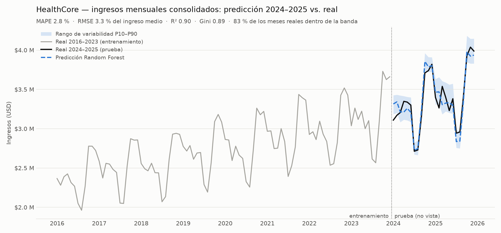

# Modelo de predicción de ventas (RFI de Finanzas)

¿Se pueden predecir los ingresos mensuales de HealthCore con un error aceptable antes de
construir el dashboard ejecutivo? **Sí:** con 8 años de historia, el modelo predijo los
24 meses de 2024–2025 sin haberlos visto y se equivocó un **2,8 % de media por mes**.
El total de los dos años quedó a un **0,06 %** del real. Para el uso que plantea Finanzas
sirve, con una salvedad importante: la ventaja del modelo frente a una regla simple es
pequeña (ver [§ Honestidad](#honestidad-lo-que-el-modelo-no-demuestra)).

| Pieza | Archivo |
| --- | --- |
| Dataset (sin alterar) | [`data/raw/healthcore_sales.csv`](../../data/raw/healthcore_sales.csv) |
| Entrenamiento y evaluación | [`scripts/train_sales_forecast.py`](../../scripts/train_sales_forecast.py) |
| Métricas | [`data/eval/sales_forecast/metrics.json`](../../data/eval/sales_forecast/metrics.json) |
| Predicción mes a mes | [`data/eval/sales_forecast/test_predictions.csv`](../../data/eval/sales_forecast/test_predictions.csv) |
| Gráfica | [`data/eval/sales_forecast/sales_forecast.png`](../../data/eval/sales_forecast/sales_forecast.png) |
| Pruebas (split 8/2 y fuga de datos) | [`tests/pipelines/test_sales_forecast.py`](../../tests/pipelines/test_sales_forecast.py) |

```bash
uv sync                                         # entorno (pyproject.toml + uv.lock)
uv run python scripts/train_sales_forecast.py   # entrena, evalúa y escribe data/eval/sales_forecast/
uv run pytest tests/pipelines/test_sales_forecast.py
```

Todo es determinista (`random_state=42`): la misma ejecución da las mismas métricas.



## Datos

- **Fuente.** `healthcore_sales.csv` del repositorio de referencia
  (`content/contexts/sales-forecasting/healthcore/`), copiado byte a byte (SHA-1
  `2fd0315e…`). No está generado ni simulado.
- **Contenido.** 120 filas `consolidated` de 2016-01 a 2025-12, con las columnas exactas
  del BRIEFING: `month`, `revenue_usd`, `visits_count`, `avg_revenue_per_visit_usd` y
  `region`. Solo hay cifras agregadas mensuales, ningún dato de pacientes.
- **Objetivo.** `revenue_usd` de la fila `consolidated`.
- **Validación.** El script valida las columnas y que cada `month` sea un primer día de
  mes. Rechaza meses faltantes y revenue no positivo.
- **Nulos.**
  - Si falta un `revenue_usd`, se reconstruye como `visits_count × avg_revenue_per_visit_usd`
    (es su producto, salvo redondeo).
  - Cualquier otro hueco interno se interpola linealmente entre sus vecinos.
  - Un nulo al principio o al final de la serie aborta, porque rellenarlo sería inventar.
  - El archivo provisto no tiene nulos (`nulls_filled: 0`).
  - Las filas sin historia suficiente para los lags (los primeros 15 meses) se descartan
    del entrenamiento; no se imputan.
- **Patrón comprobado.**
  - **Crecimiento anual:** entre +1,2 % y +6,9 %, alternando alto y bajo.
  - **Octubre–diciembre:** índice estacional ≈ 1,15.
  - **Julio–agosto:** índice estacional ≈ 0,83.
  - **Resto del año:** entre 0,97 y 1,00.

  Coincide con el BRIEFING, y el modelo lo reproduce sin alterar los datos.

## Split 8 años / 2 años, sin fuga

- **Entrenamiento:** 2016–2023 (96 meses). **Prueba:** 2024–2025 (24 meses). El corte es
  por año natural, nunca aleatorio, y los dos conjuntos no comparten ningún mes.
- **Pronóstico recursivo a 24 meses desde 2023-12.** Para predecir marzo de 2025, los
  lags de enero y febrero de 2025 son **predicciones del propio modelo**, no los valores
  reales. El modelo no recibe ni un solo valor de 2024–2025, ni para entrenar ni como
  entrada. Es la situación real de Finanzas al pedir "los próximos meses".
- **Pruebas.** `tests/pipelines/test_sales_forecast.py` lo comprueba:
  - años 2016–2023 y 2024–2025, 96 y 24 meses, sin solapamiento y en orden;
  - las features de un mes no cambian si se alteran los meses posteriores;
  - multiplicar ×3 todos los ingresos de 2024–2025 deja idénticas las predicciones, la
    banda y las importancias (solo cambian las métricas);
  - dos ejecuciones dan exactamente el mismo resultado.

## Features y escalado

| Feature | Qué captura |
| --- | --- |
| `month_of_year`, `month_sin`, `month_cos` | Calendario |
| `is_flu_season` (oct–dic), `is_summer_dip` (jul–ago) | Las dos temporadas del BRIEFING |
| `lag_1_ratio`, `lag_2_ratio`, `lag_3_ratio` | Inercia de los últimos meses |
| `lag_12_ratio` | El mismo mes del año pasado (estacionalidad) |
| `rolling_mean_3_ratio`, `rolling_std_12_ratio` | Media de 3 meses y volatilidad de 12 |
| `yoy_growth_3m` | Crecimiento interanual del último trimestre |

- **Escalado.** Todas las variables de ingresos se dividen por el **nivel**, la media de
  los 12 meses anteriores. Sin eso, un mes de 2016 (~2,4 M) y uno de 2025 (~3,4 M) serían
  incomparables. Ese es el escalado que de verdad importa en esta serie.
- **`StandardScaler`.** También va en el `Pipeline`, ajustado solo con el entrenamiento.
  No cambia las predicciones de los árboles, que cortan por umbrales; se deja para que
  la matriz de features tenga una sola escala si alguien cambia a un modelo sensible a
  la escala.
- **Variable objetivo: `revenue / nivel`, no los dólares.** Un árbol no puede predecir
  por encima del máximo que vio en el entrenamiento, y casi todos los meses de prueba
  superan esos valores por el crecimiento. Prediciendo el ratio, el nivel sale de la
  propia serie y el crecimiento se conserva.

## Por qué Random Forest y no XGBoost

| Criterio | Random Forest | XGBoost |
| --- | --- | --- |
| Tamaño de datos (81 filas de entrenamiento) | Promedia árboles con bootstrap; funciona casi con la configuración por defecto | Encadena árboles sobre los residuos; con tan pocas filas sobreajusta salvo que se afinen learning rate, profundidad y rondas, y no hay años de sobra para una ventana de ajuste aparte |
| Explicabilidad para Finanzas | "500 árboles votan y se promedia", con importancias directas | Correcciones secuenciales, más difíciles de contar |
| Rango de variabilidad | Sale gratis de la dispersión de los 500 árboles | Requiere modelos de cuantiles adicionales |
| Tiempo de entrenamiento | Menos de 1 s | Menos de 1 s (no decide) |

El stakeholder pidió explicabilidad ("que no parezca una caja negra") y los datos son
pocos, así que Random Forest es la elección. La configuración es `n_estimators=500`,
`min_samples_leaf=2`, `max_features=0.5` y `random_state=42`.

**Importancias.** El mismo mes del año anterior (`lag_12_ratio`, 38 %) y las dos
temporadas (verano 18 %, gripe 12 %) explican la mayor parte. Es exactamente el patrón
que describe el BRIEFING.

## Métricas sobre la prueba (2024–2025)

| Métrica | Valor | Qué mide |
| --- | --- | --- |
| **MSE** | 1,26 × 10¹⁰ USD² | Media del error al cuadrado. Penaliza mucho los fallos grandes, pero está en USD² y no se lee directamente. |
| RMSE | 112 394 USD = **3,3 % del ingreso mensual medio** | La raíz del MSE, vuelta a dólares y expresada sobre el ingreso medio (3,37 M), como pide el BRIEFING. |
| **MAPE** (para Finanzas) | **2,8 %** | "De media, cada mes nos equivocamos un 2,8 %". Es la métrica para explicar a Finanzas. |
| MAE | 93 931 USD | Error absoluto medio por mes. |
| Sesgo | −0,06 % | Suma predicha frente a suma real: 80,75 M frente a 80,80 M. No hay subestimación ni sobreestimación sistemática. |
| **K2 Score** (R²) | **0,90** | Qué parte de la variación mes a mes explica el modelo. 1 = toda; 0 = lo mismo que predecir siempre la media. |
| K² de D'Agostino (residuos) | 0,46 (p = 0,79) | Normalidad de los errores. p > 0,05: errores sin forma anómala ni sesgo oculto. |
| **Gini** normalizado | **0,89** | Si el modelo ordena los meses como la realidad (1 = orden perfecto). Es lo que pide Sandra: distinguir un agosto normal de una caída atípica. |
| **PSI** del score del modelo | **0,15** (moderado) | Cuánto cambió la distribución de lo que predice el modelo entre entrenamiento y prueba. |
| Cobertura de la banda P10–P90 | **83 %** (20 de 24 meses) | Meses reales dentro del rango de variabilidad. La meta nominal es ~80 %, así que está bien calibrada. Ancho medio: ±4,3 %. |

**El "K2 Score" del ticket.** Lo interpreto como R² (`r2_score` de scikit-learn). Como
también podría referirse al test K² de D'Agostino-Pearson, reporto los dos.

**Cómo se calculan el Gini y el PSI:**
- **Gini.** Se ordenan los meses por la predicción y se mide cuánto ingreso real se
  acumula arriba, normalizado por el orden perfecto.
- **PSI.** `Σ (test% − train%) · ln(test% / train%)` sobre 5 quintiles del
  entrenamiento; con 24 meses, 10 bins dejarían unos 2 meses por bin. Umbrales:
  - menos de 0,10: estable;
  - de 0,10 a 0,25: cambio moderado;
  - más de 0,25: cambio significativo.

### Por qué un MSE bajo no basta

- **Depende de la escala.** 1,26 × 10¹⁰ USD² no dice si es mucho o poco hasta
  convertirlo en un 3,3 % del ingreso. El mismo error sería pequeño para la red entera
  y enorme para una clínica.
- **No dice si se acierta la forma.** Un modelo que predijera cada mes el promedio anual
  podría tener un MSE "razonable" y fallar justo en lo que importa, los picos de
  octubre–diciembre y los valles de julio–agosto. Para eso están el R² y el Gini.
- **No detecta el sesgo.** Errores pequeños siempre hacia abajo suman un presupuesto
  mal hecho; para eso está el sesgo total.
- **No avisa de que los datos cambiaron.** Para eso está el PSI.
- **Medido sobre el entrenamiento engaña.** Dentro de la muestra el modelo da un MAPE del
  1,2 % y un R² de 0,99; en la prueba, 2,8 % y 0,90. La cifra que vale es la de la
  prueba: un MSE bajo en entrenamiento solo demuestra que el modelo memorizó el pasado.

### PSI: qué cambió entre entrenamiento y prueba

| Variable | PSI | Lectura |
| --- | --- | --- |
| Score del modelo (ratio estacional predicho) | 0,15 | Moderado. La prueba se concentra en ratios algo distintos a los del entrenamiento; vigilarlo cuando llegue 2026. |
| Ratio estacional real | 0,02 | Estable: la estacionalidad de 2024–2025 es la misma que la de 2016–2023. |
| `avg_revenue_per_visit_usd` | 0,48 | Significativo según el umbral, aunque en dólares es pequeño (media 179,2 → 181,6 USD, +1,3 %). Puede reflejar un cambio de mezcla EE. UU./Reino Unido o de precios. Conviene que Revenue Cycle lo revise. |
| `revenue_usd` en bruto | 4,07 | Esperado: con el crecimiento, el 83 % de los meses de prueba supera el percentil 80 del entrenamiento. No es un problema del modelo, que predice ratios. Es justo el motivo para no predecir dólares directamente. |
| Mezcla de visitas EE. UU./Reino Unido | — | No se puede calcular: el archivo solo trae la fila `consolidated`. El ingreso por visita es el indicador indirecto. |

## Honestidad: lo que el modelo no demuestra

- **La línea base simple casi empata.** Tomar el mismo mes de 2023 y aplicarle el
  crecimiento medio da un MAPE del 2,79 % frente al 2,81 % del modelo y un R² de 0,89
  frente a 0,90.
  - El modelo gana en MSE (−11 %) y en R², pero no por mucho, porque la serie es muy
    regular.
  - La conclusión para Finanzas es que **la serie es muy predecible**. El valor del
    modelo está en la banda de variabilidad calibrada y en adaptarse a cambios de ritmo,
    no en una precisión espectacular.
- **Los mayores errores** (±6–7 %) están en enero–marzo, meses que el BRIEFING describe
  como "±5 % de fluctuación moderada". Los picos y valles estacionales los acierta mejor
  (julio y agosto de 2024, por debajo del 1 %).
- **Solo hay 2 años de prueba.** Es una evaluación de 24 puntos; la cifra de 2,8 % es
  orientativa, no una garantía.
- **Comprobación en el entrenamiento (OOB).** El error estimado con los árboles que no
  vieron cada fila es un MAPE del 2,6 %, en línea con la prueba. No hay señales de
  sobreajuste grave.

## Rango de variabilidad

- Cada uno de los 500 árboles genera **su propia trayectoria recursiva de 24 meses**, en
  la que sus predicciones alimentan sus siguientes lags.
- La banda es el percentil 10–90 de esas trayectorias mes a mes. Así, la incertidumbre
  se acumula con el horizonte, como en un plan real.
- 20 de los 24 meses reales caen dentro. Los 4 que quedan fuera son enero, febrero y
  octubre de 2024 y febrero de 2025.
