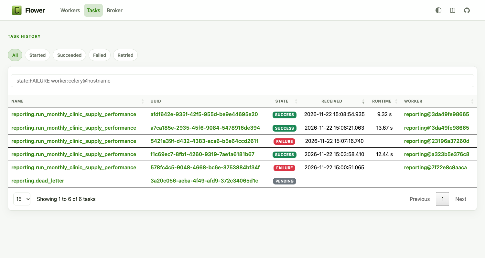
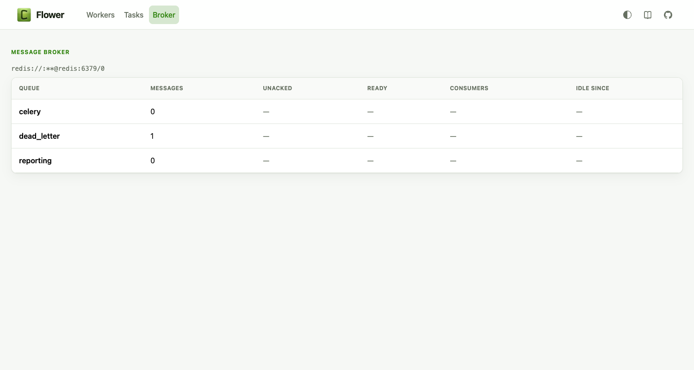
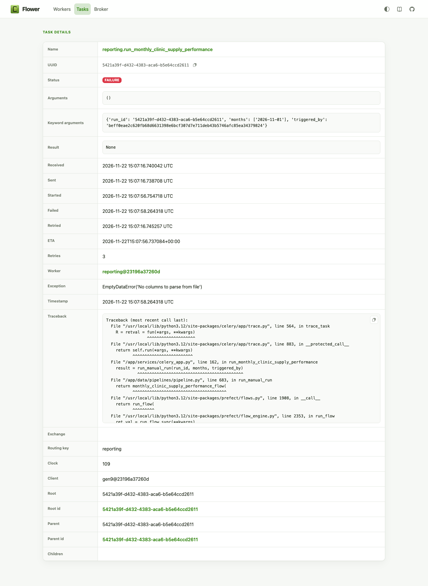

# Cola de tareas asíncronas (Celery + Redis, ticket DEV-55)

```text
Cliente ─► API FastAPI (productor) ─► Redis (broker) ─► worker Celery (consumidor) ─► Redis (resultado)
                    │                                              │
                    └─ 202 {task_id} al instante                   └─ reporting.task_dead_letters (DLQ)
```

| Pieza | Archivo |
| --- | --- |
| App de Celery, tarea, reintentos y DLQ | [`services/celery_app.py`](../../services/celery_app.py) |
| Registro de la DLQ | [`services/task_dead_letters.py`](../../services/task_dead_letters.py) y [migración](../../supabase/migrations/20261122180000_reporting_task_dead_letters.sql) |
| Productor | `POST /reporting/pipeline-runs` en [`services/reporting/router.py`](../../services/reporting/router.py) |
| Estado | `GET /tasks/{task_id}` en [`services/api/routes/tasks.py`](../../services/api/routes/tasks.py) |
| Infraestructura | `redis`, `worker` y `flower` en [`docker-compose.yml`](../../docker-compose.yml) |
| Tests | `services/api/tests/test_tasks.py`, `services/api/tests/test_reporting.py` y `tests/services/test_celery_tasks.py` |

## Operación asíncrona: `POST /reporting/pipeline-runs`

Es la operación más lenta de la API: corre el pipeline de negocio completo, que
extrae de `telemetry_events`, calcula los KPIs y carga en
`reporting.monthly_clinic_supply_performance`. Tarda entre 7 y 16 s por corrida,
frente a los ~2 s del primer `GET /telemetry/report`. Hasta DEV-55 se ejecutaba
en un hilo dentro del proceso de FastAPI.

- **Productor (API):** solo toca Redis, sin consultas a la base de datos, para
  responder en menos de 200 ms. Medido: entre 5 y 36 ms.
  1. Genera `run_id`, que también es el `task_id`.
  2. Reserva la corrida manual con `SET NX EX` en Redis. Si ya hay una en cola
     o en curso, responde `409`.
  3. Guarda un registro `PENDING` en el backend de resultados.
  4. Publica el mensaje y responde `202 {"task_id", "run_id", "status": "accepted"}`.

  Si Redis no está disponible, responde `503` y libera la reserva.
- **Mensaje:** solo identificadores, ~150 bytes en JSON (sin pickle):
  `{"run_id": "…", "months": ["2026-11-01"], "triggered_by": "<HMAC de 64 hex>"}`.
  El worker lee la telemetría de la base de datos por su cuenta.
- **Consumidor (worker):** `reporting.run_monthly_clinic_supply_performance`
  llama a `data.pipelines.pipeline.run_manual_run`. El flow registra el `run_id`
  en `pipeline_runs`, así que tarea, corrida y DLQ comparten un mismo
  identificador.

## `GET /tasks/{task_id}`

```json
{"task_id": "…", "status": "success", "attempt": 1, "result": {"run_id": "…", "status": "completed", "rows_changed": 0}, "dead_letter": null}
```

- **`status`:** el estado real de Celery en minúsculas: `pending` (en cola),
  `started` (`task_track_started`), `retry` (esperando el siguiente intento),
  `success` o `failure`.
- **`result`:** el resumen del pipeline si terminó bien, o `{"error": "Tipo: mensaje"}`
  si está en `retry` o `failure`.
- **`dead_letter`:** solo con `failure`; es el registro de la DLQ.
- **Errores:** `404` si el id nunca se encoló (Celery por sí solo diría `PENDING`
  de cualquier id), `503` si Redis no responde. Requiere sesión.

## Fiabilidad

| Regla | Cómo |
| --- | --- |
| ACK solo tras éxito | `task_acks_late` y `task_reject_on_worker_lost`. Si el worker muere a mitad de tarea, el mensaje vuelve a la cola. |
| Timeout | `soft_time_limit` 900 s (`CELERY_TASK_SOFT_TIME_LIMIT`) y `time_limit` 960 s. Un timeout cuenta como fallo y se reintenta. |
| Reintentos | `max_retries=3` con backoff exponencial: 10, 20 y 40 s (`CELERY_RETRY_BASE_SECONDS`). Nunca un reintento inmediato. Reintentar es seguro porque el pipeline es idempotente con el mismo `run_id`. |
| DLQ | Tras el 4.º intento (1 + 3 reintentos), una fila en `reporting.task_dead_letters` (`task_id`, `attempt`, `error_type`, `error_message`, traceback, `failed_at`) y un mensaje en la cola `dead_letter`. Ningún worker la consume, así que queda visible en Flower → Broker. Se inspecciona con `celery -A services.celery_app worker -Q dead_letter`. |
| Broker persistente | Redis con `appendonly yes`, `maxmemory-policy noeviction` y el volumen `redis_data`. |
| Procesos separados | La API, el worker y Flower son contenedores distintos. Detener la API no detiene el worker ni pierde mensajes. |

## Logs

Cada intento deja una línea con `task_id`, intento, estado resultante y
duración. Los fallos añaden el error completo con su traceback:

```text
INFO    task_id=… attempt=1/4 status=started duration=0.00s run_id=… months=['2026-11-01']
WARNING task_id=… attempt=1/4 status=retry duration=8.42s next_attempt_in=10s error=EmptyDataError: No columns to parse from file
                  Traceback (most recent call last): …
ERROR   task_id=… attempt=4/4 status=failure duration=1.25s dead_letter=true error=EmptyDataError: No columns to parse from file
                  Traceback (most recent call last): …
```

## Evidencia (Flower)




