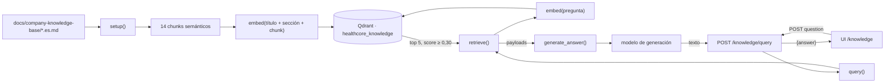
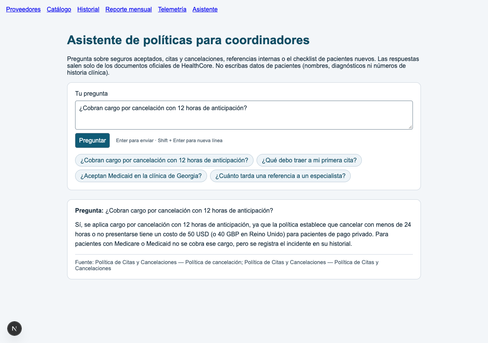

# Diseño RAG: base de conocimiento de HealthCore (Hito 7)

Asistente para los 8 coordinadores de pacientes de Priya Nair (Head of Patient Experience).
Responde en recepción y por teléfono preguntas sobre seguros, citas, referencias y pacientes
nuevos, "como lo haría el mejor vendedor de servicios de la clínica", y solo con lo que dicen
los documentos oficiales.

| Pieza | Archivo |
| --- | --- |
| Corpus (4 documentos del BRIEFING, sin alterar) | [`docs/company-knowledge-base/`](../company-knowledge-base/) |
| `setup()`, `embed()` y chunking | [`data/process/rag.py`](../../data/process/rag.py) |
| `retrieve()`, `generate_answer()` y `query()` | [`data/pipelines/rag.py`](../../data/pipelines/rag.py) |
| Endpoint `POST /knowledge/query` | [`services/api/routes/knowledge.py`](../../services/api/routes/knowledge.py) |
| UI «Asistente» (`/knowledge` del backoffice) | [`uis/backoffice/src/app/knowledge/page.tsx`](../../uis/backoffice/src/app/knowledge/page.tsx) |
| Pruebas unitarias (Qdrant y LLM simulados) | [`tests/pipelines/test_rag.py`](../../tests/pipelines/test_rag.py) y [`services/api/tests/test_knowledge.py`](../../services/api/tests/test_knowledge.py) |
| Eval de retrieval | [`data/eval/test-queries.json`](../../data/eval/test-queries.json), [`evaluate_rag_retrieval.py`](../../data/eval/evaluate_rag_retrieval.py), [resultados](../../data/eval/rag_retrieval_results.json) y [respuestas generadas](../../data/eval/rag_answers.md) |
| Qdrant | Servicio `qdrant` (`qdrant/qdrant:v1.20.2`) en `docker-compose.yml` |

## 1. Proceso RAG de extremo a extremo



1. **Corpus.** Los cuatro documentos de la sección 2 del BRIEFING se copian sin cambios
   desde `00-general-contexts/healthcore/` a `docs/company-knowledge-base/`.
2. **`setup()`** (`python -m data.process.rag`):
   - lee los cuatro archivos (si falta alguno, falla; no lo salta);
   - los divide en chunks (§2);
   - llama a `embed()` con cada uno;
   - hace upsert en la colección **`healthcore_knowledge`**.
3. **Payload de cada punto**, exactamente el del BRIEFING:

   ```json
   {"company": "healthcore", "source_document": "appointment-policy", "section": "Política de cancelación",
    "language": "es", "chunk_index": 1, "text": "Política de cancelación:\n- Cancelar con más de 24 horas…"}
   ```

4. **Idempotencia: IDs deterministas.** Cada punto tiene `id = uuid5(namespace,
   "healthcore:<source_document>:<chunk_index>")`.
   - **Repetir `setup()` no duplica.** Sobrescribe los mismos 14 puntos (verificado: 14
     antes y después).
   - **Limpieza.** Si un documento queda con menos chunks, `setup()` borra los puntos
     sobrantes.
   - **Colección.** Solo se recrea si cambia la dimensión del vector, es decir, si se
     cambia el modelo de embeddings.
   - **Por qué no limpiar y recargar siempre.** Con IDs deterministas, la colección nunca
     queda vacía mientras se reindexa.
5. **`retrieve(query, *, k=5, min_score=0.30)`:**
   - embebe la pregunta con el mismo `embed()`;
   - busca los k vecinos más cercanos;
   - descarta los que tienen una similitud menor que `min_score`.

   Devuelve diccionarios con el payload más el `score`, nunca objetos del SDK de Qdrant.
   Puede devolver menos de k resultados, o ninguno.
6. **`generate_answer(question, context)`:** arma el prompt (§4) y llama al **modelo de
   generación**. Si `context` está vacío, también llama al modelo, con la instrucción
   explícita de decir que no hay información. La respuesta siempre la genera el modelo.
7. **`query(question)`** es literalmente `generate_answer(question, retrieve(question))` y
   es lo único que llama la API. El agente LangGraph del siguiente proyecto podrá llamar a
   `retrieve()` y a `generate_answer()` como dos nodos separados.
8. **`POST /knowledge/query`:**
   - **Petición y respuesta.** Recibe `{"question": "..."}` (entre 3 y 1000 caracteres,
     sin campos extra) y responde `{"answer": "..."}`. Requiere sesión, como el resto del
     backoffice.
   - **Sin lógica propia.** El router solo valida y llama a `query()`.
   - **Errores.** Si falla Qdrant o el modelo, responde **503**, nunca una respuesta vacía.
   - **Log del servidor.** Los chunks recuperados y sus similitudes solo van al log, por
     ejemplo:

     ```text
     rag.query retrieve k=5 min_score=0.30 hits=[('appointment-policy', 1, 0.61), …] kept=4
     ```

9. **UI.** La página «Asistente» del backoffice envía la pregunta y muestra la respuesta,
   con la línea `Fuente:` separada debajo.
   - **Carga.** Muestra «Consultando…» con el botón deshabilitado.
   - **Error.** Muestra un mensaje en rojo con `role="alert"`, distinto de una respuesta.



## 2. Estrategia de chunking

**Corpus.** Son cuatro documentos cortos (de 1,0 a 1,2 KB). Cada uno es una lista de
reglas agrupadas en bloques con etiqueta ("Política de cancelación:", "Reino Unido
(Londres y Manchester):") o en párrafos sueltos que expresan una regla completa ("Un
paciente con 3 no-shows…").

**Estrategia: por sección semántica, no por tamaño fijo.**

| Regla | Por qué |
| --- | --- |
| Los bloques se separan por líneas en blanco; un encabezado Markdown (`#`, `##`) abre una sección nueva | Es la frontera natural de una regla en estos documentos. |
| Un bloque que termina en ":" va siempre junto al siguiente ("el proceso estándar es:" + los 4 pasos; "Política de cancelación:" + sus 3 condiciones) | Una regla nunca se separa de su condición. El cargo de 50 USD/40 GBP y la excepción de Medicare/Medicaid están en el **mismo chunk**, que es lo que exige el BRIEFING (§6), y hay un test que lo comprueba. |
| `section` es la etiqueta del bloque ("Reserva de citas", "Recordatorios automáticos", "Estados Unidos (Texas, Florida, Georgia)"); un párrafo sin etiqueta toma el título del documento | Hace que cada respuesta sea trazable a su fuente y que un error se pueda depurar. |
| Las líneas cortadas a mano se vuelven a unir; cada viñeta sigue en su propia línea | El texto del prompt no tiene frases partidas. |
| Red de seguridad: si una sección supera 1200 caracteres, se corta entre viñetas o entre frases, nunca dentro de una | Hoy no se activa: los chunks miden entre 141 y 554 caracteres. |

**Chunks por documento.** Son 14 en total, y cada documento cumple el mínimo de 3 del
BRIEFING:

| `source_document` | Chunks | Secciones |
| --- | --- | --- |
| `insurance-coverage` | 3 | EE. UU. (con la introducción "según el país"), Reino Unido y la regla de no confirmar seguros no listados |
| `appointment-policy` | 4 | Reserva de citas, Política de cancelación, Recordatorios automáticos y la regla de los 3 no-shows |
| `referral-process` | 4 | Los 4 pasos, el tiempo objetivo de 11 días, el escalado a los 5 días hábiles y las referencias fuera de la red |
| `new-patient-checklist` | 3 | Lo que se completa antes de la cita, lo que se trae ese día y qué pasa si falta el historial |

**Descartado:**
- **Tamaño fijo con solapamiento.** Partiría las condiciones; por ejemplo, separaría
  "para pacientes de pago privado" del importe.
- **Un vector por documento.** Las 4 reglas de citas competirían en un solo vector.

**Pruebas.** Un test comprueba que, sumando los chunks de cada documento, se obtiene el
texto fuente completo: no se pierde ni se duplica nada.

## 3. Prácticas de embeddings

| Parámetro | Valor |
| --- | --- |
| Modelo de embeddings (`EMBEDDING_MODEL`) | `madrid-spain/openrouter/perplexity/pplx-embed-v1-0.6b`, del gateway de 4Geeks (`LLM_API_URL=https://llm.4geeks.ai`) |
| Modelo de generación (`GENERATION_MODEL`) | `madrid-spain/openrouter/deepseek/deepseek-v4-flash`, del mismo gateway; es un modelo de chat **distinto**, y `settings()` se niega a arrancar si ambos IDs coinciden |
| Dimensión | 1024 (la colección se crea con la dimensión del primer vector) |
| Distancia en Qdrant | Coseno (`Distance.COSINE`) |
| `min_score` | **0,30**, configurable con `RAG_MIN_SCORE` |
| `k` | 5 en `query()`; 3 para medir el Recall@3 |
| Cliente | SDK `openai` apuntando al gateway compatible de 4Geeks, configurado por variables de entorno (`services/api/.env`, que no se versiona) |

**Mismo `embed()` al indexar y al consultar.**
- **Al indexar:** se embebe `"<título>. <sección>.\n<texto>"`. El encabezado da contexto a
  reglas cortas: "sin cargo" queda asociado a "Política de cancelación".
- **Al consultar:** se embebe la pregunta.
- **Preprocesado común:** Unicode NFC (una tilde compuesta y una precompuesta quedan
  iguales), se quitan las viñetas Markdown y se colapsan los espacios. No se pasa a
  minúsculas ni se quitan tildes: el modelo es multilingüe y las trata bien.

### Cómo se ajustó `min_score`

Corrí `retrieve(question, k=5, min_score=0)` sobre las 19 preguntas del eval, 4 fuera de
tema y 3 del dominio sin respuesta en los documentos:

| Grupo | Similitud |
| --- | --- |
| Chunk correcto de las 19 preguntas | **de 0,340 a 0,765** |
| Mejor chunk de 4 preguntas fuera de tema (paella, fútbol, impresora, películas) | **0,026 a 0,184** |
| "¿Cuánto cuesta una resonancia magnética?" | 0,236 |
| "¿Las clínicas tienen estacionamiento gratuito?" | 0,349 |
| "¿Aceptan el seguro Humana en Texas?" | 0,537 (recupera, con razón, el chunk de seguros de EE. UU.) |

**0,30** queda 0,12 por encima del ruido fuera de tema y por debajo del chunk correcto
más débil (0,34, la pregunta del descuento self-pay).
- **El primer valor provisional, 0,40, descartaba ese chunk:** el coordinador habría
  recibido «no hay información» sobre el 20 % de descuento, que sí está documentado. Por
  eso lo bajé.
- **Un umbral más bajo (0,25) dejaría pasar la resonancia magnética** sin aportar
  aciertos.

**Dos capas contra respuestas inventadas:**
1. **El umbral.** Elimina lo que no tiene que ver con el tema: las 4 preguntas fuera de
   tema y la de la resonancia llegan al modelo **sin contexto**.
2. **El prompt.** Cubre lo que es del dominio pero no está documentado. El
   estacionamiento supera el umbral con chunks que no responden, y el modelo contesta que
   la base de conocimiento no tiene información. Humana recupera la lista de seguros, y el
   modelo dice que no está listado y que se verifique con facturación (Tom Callahan). Las
   dos respuestas están en [`rag_answers.md`](../../data/eval/rag_answers.md).

## 4. Prompt de generación: voz y reglas del BRIEFING

El *system prompt* (`SYSTEM_PROMPT` en `data/pipelines/rag.py`) da al modelo:

- **Voz y audiencia.** Asistente de mostrador para los coordinadores del equipo de Priya
  Nair, "como el mejor vendedor de servicios de la clínica": claro, cálido, empático y sin
  prometer nada que no esté documentado. Se dirige al coordinador, que puede leerle la
  respuesta al paciente.
- **Solo el CONTEXTO.** Las cifras, tarifas, plazos y nombres de seguros se copian
  exactamente (faithfulness del BRIEFING §4).
- **Sin añadidos.** No se añaden pasos, consecuencias ni contactos no documentados. Una
  primera versión del prompt inventaba cosas como "después deberá llamarnos" o "equipo de
  instalaciones"; esta regla las eliminó.
- **Contactos para derivar**, solo los documentados:
  - Tom Callahan (facturación) para seguros y precios;
  - Marcus Reid para referencias;
  - Priya Nair para lo demás.
- **Seguros no listados.** Nunca se confirman: hay que verificarlos con facturación.
- **País no indicado.** Una pregunta de seguros sin país se responde distinguiendo
  **Estados Unidos y Reino Unido**. Ejemplo: «¿Qué seguros privados aceptan?» responde
  con BCBS/Aetna/Cigna/UnitedHealthcare para EE. UU. y Bupa/AXA Health para Reino Unido.
- **No-show con Medicare o Medicaid.** Nunca hay cargo; se registra el incidente.
- **Datos de pacientes.** Ni se incluyen ni se piden.
- **Fuente.** Toda respuesta termina con una línea `Fuente: Documento — Sección`, o
  `Fuente: ninguna`.

El contexto llega al modelo con un encabezado por chunk: `[Política de Citas y
Cancelaciones — Política de cancelación]`. La temperatura es 0,1, para que repita las
cifras de forma estable.

## 5. Evaluación de retrieval: Recall@3

```bash
python -m data.process.rag                               # indexar
python data/eval/evaluate_rag_retrieval.py               # Recall@3 → data/eval/rag_retrieval_results.json
python data/eval/evaluate_rag_retrieval.py --with-answers  # + respuestas → data/eval/rag_answers.md
```

**Set de preguntas.** `test-queries.json` tiene **19 preguntas**: 6 de seguros, 5 de
citas, 4 de referencias y 4 de pacientes nuevos. Están parafraseadas como las haría un
coordinador, no copiadas del documento. Hay un acierto si el chunk esperado
(`source_document` + `chunk_index`) aparece entre los 3 primeros resultados.

| Métrica | Resultado |
| --- | --- |
| **Recall@3** | **94,7 % (18 de 19)**, meta del BRIEFING ≥ 80 % |
| MRR | 0,932 (17 preguntas tienen el chunk correcto en primer lugar) |
| Fallo | `ins-02` «Un paciente sin seguro, ¿tiene algún descuento si paga el mismo día?»: el chunk de EE. UU. queda 5.º (0,34). Ese chunk mezcla cinco reglas y el término "self-pay" está en inglés. Como queda en el top 5 y por encima del umbral, `query()` sí responde bien el 20 % de descuento. |
| `ref-01` | El chunk correcto queda 2.º, por detrás de "referencias fuera de la red", que también es pertinente. |

**Fidelidad de las respuestas.** Revisé a mano las 26 respuestas generadas
(`rag_answers.md`):
- Todas las cifras (50 USD/40 GBP, 24 h, 4 h, 3–5 días, 11 días, 5 días hábiles,
  20 %, 3 no-shows en 6 meses) coinciden con los chunks.
- Ninguna respuesta cobra no-show a pacientes de Medicare o Medicaid.
- Las 7 preguntas sin respuesta en los documentos reciben «la base de conocimiento no
  tiene información» o, en el caso de Humana, la derivación a facturación, sin inventar
  datos.

## 6. Operación

```bash
docker compose up -d qdrant          # Qdrant en localhost:6333 (volumen qdrant_data)
python -m data.process.rag           # o: docker compose exec api python -m data.process.rag
```

- **Configuración** (en `services/api/.env`, sin versionar): `LLM_API_URL`,
  `LLM_API_KEY`, `EMBEDDING_MODEL`, `GENERATION_MODEL`, `QDRANT_URL` (por defecto
  `http://localhost:6333`; en Compose, `http://qdrant:6333`) y, opcionalmente,
  `QDRANT_API_KEY` y `RAG_MIN_SCORE`.
- **Latencia observada:** de 2 a 10 s por pregunta, casi todo de la generación. El
  embedding tarda menos de 1 s.
- **Pruebas:**

  ```bash
  python -m pytest tests/pipelines/test_rag.py services/api/tests/test_knowledge.py
  ```

  No necesitan Qdrant ni LLM en vivo y también corren en el CI.

## 7. Limitaciones

- **Solo español.** El corpus es el de la versión `.es` (`language: "es"`). Preguntas en
  inglés recuperan peor.
- **Sin memoria de conversación.** Cada pregunta es independiente (RAG no es memoria). El
  agente del siguiente hito puede añadirla.
- **Sin modo oscuro.** El backoffice no tiene tema oscuro todavía, así que la página
  «Asistente» usa los mismos estilos claros que el resto.
- **Reindexado manual.** Si cambian los documentos, hay que volver a ejecutar `setup()`;
  no hay reindexado automático.
