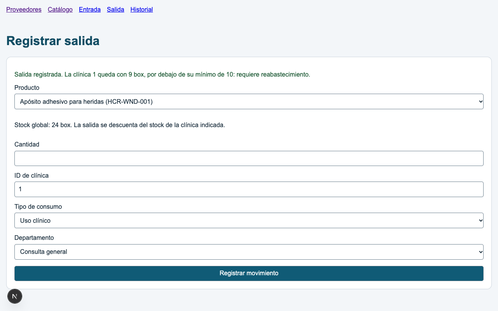
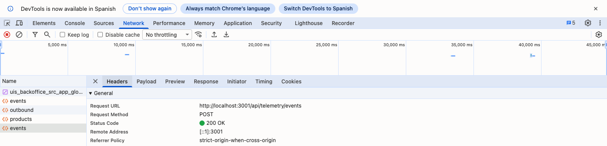
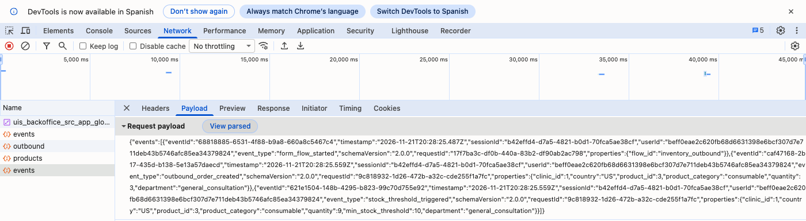
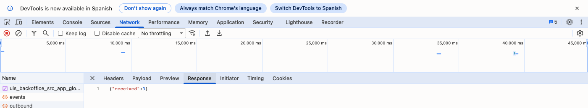

# Telemetría: captura en backoffice

## Alcance implementado

Contrato: [event-schemas.json](./event-schemas.json), versión `2.1.0` (aditiva sobre `2.0.0`: `total_cost` en `inbound_order_created`; ver [telemetry-plan.md](./telemetry-plan.md#cambio-aditivo-210)).
Diseño: [telemetry-plan.md](./telemetry-plan.md).

Se instrumentaron **21 de 25 eventos**, incluidos **los 5 obligatorios** del
BRIEFING, y el piso técnico transversal: errores de frontend, latencia de API y
navegación. El receptor `POST /telemetry/events` valida cada evento contra el contrato y los persiste en
Supabase: ver [event-storage.md](./event-storage.md).

Todos los eventos pasan por `track()` en
[`telemetry.ts`](../../uis/backoffice/src/services/telemetry.ts). Los componentes
no construyen envelopes ni envían lotes directamente.

### Obligatorios del BRIEFING

| Evento | Punto de captura | Fuente del dato |
| --- | --- | --- |
| `inbound_order_created` | `createInbound()` en `src/lib/inventory.ts`, llamado por `InventoryMovementForm` (entrada) tras el 201 | Respuesta de `POST /inventory/orders/inbound`; `supplier_id: null` hasta que la entrada referencie el directorio |
| `outbound_order_created` | `createOutbound()` en `src/lib/inventory.ts`, llamado por `InventoryMovementForm` (salida) tras el 201 | Respuesta de `POST /inventory/orders/outbound`; `department` elegido en el formulario |
| `stock_threshold_triggered` | `createOutbound()`, mismo commit que la salida | La API calcula el cruce por clínica (`stock_threshold` en la respuesta) solo en el flanco de bajada bajo `clinic_stock_minimum` |
| `direct_stock_edit_rejected` | `attemptDirectStockEdit()` en `src/lib/inventory.ts`, panel «Ajuste directo de stock» del catálogo | Rechazo 403 explícito de `PUT /inventory/clinics/{clinic_id}/products/{product_id}/stock` |
| `supply_expiry_flagged` | `listExpiring()` en `src/lib/inventory.ts`, panel «Por vencer en 30 días» del catálogo | `GET /inventory/expiring`: stock por clínica de insumos con `expiry_date` en ≤ 30 días |

`country` sale del producto hasta que exista una tabla de clínicas. Un insumo sin
`product_category` (creado antes de 2.0.0 y no migrado) no emite eventos de
inventario, porque no puede cumplir el contrato.

`supply_expiry_flagged` se captura en el backoffice al cargar el panel y se
deduplica por `clinic_id + product_id + expiry_date` en `localStorage` del
navegador. Distintos navegadores pueden emitir el mismo aviso: la Fase 3 debe
deduplicar en almacenamiento por esa clave (o mover el productor a un job diario,
como prevé el plan).

### Identificados (propuestas propias)

| Evento | Categoría | Punto de captura |
| --- | --- | --- |
| `inventory_order_validation_failed` | Negocio | `request()` en `src/lib/inventory.ts`, HTTP 422; campos/códigos permitidos, agrupación de 5 s |
| `inventory_outbound_insufficient_stock_rejected` | Negocio | `request()` en `src/lib/inventory.ts`, HTTP 400 con stock de la clínica en `X-Available-Stock` |
| `inventory_orders_viewed` | Navegación | `listOrders()` en `src/lib/inventory.ts`; deduplicación de 30 s |
| `supplier_created` | Negocio | `src/lib/suppliers.ts`, alta confirmada |
| `supplier_rate_updated` | Negocio | `src/lib/suppliers.ts`; dirección respecto a la tarifa mostrada, sin monto |
| `supplier_status_changed` | Negocio | `src/lib/suppliers.ts`; estado previo y nuevo, sin ID |
| `supplier_filter_applied` | Navegación | `src/lib/suppliers.ts`; debounce de 500 ms y tamaño agrupado |
| `form_flow_started` | Funnel | Hook `useTelemetryFlow`; primer cambio en formulario de entrada/salida |
| `form_flow_abandoned` | Funnel | Hook `useTelemetryFlow`; desmontaje/pagehide sin envío completado |
| `frontend_route_viewed` | Navegación | `TelemetryProvider` → `trackNavigation()`; solo rutas canónicas, deduplicación de 30 s |
| `frontend_unhandled_error` | Errores | Listeners `error`/`unhandledrejection` en `telemetry.ts` y Error Boundary `src/app/error.tsx` |
| `api_latency_aggregated` | Rendimiento | `telemetryFetch()` en `telemetry.ts`; ventanas de 60 s con p50/p95 |
| `auth_login_succeeded` | Autenticación | `captureAuthentication()` desde `src/lib/auth.ts` |
| `auth_login_failed` | Autenticación | `src/lib/auth.ts` / `captureAuthentication()`; `invalid_credentials`, `rate_limited` o `service_unavailable`, nunca credenciales |
| `auth_session_rejected` | Autenticación | `telemetryFetch()` ante HTTP 401 de inventario/proveedores |
| `auth_password_recovery_requested` | Autenticación | `captureAuthentication()`; respuesta neutral |

La latencia se mide desde el navegador hasta el proxy de Next.js y su API, no
como duración exclusiva de FastAPI. Se conservan hasta 1000 muestras por grupo
ruta/método/clase HTTP por ventana; no incluye solicitudes abortadas o sin
respuesta HTTP. El indicador informativo `<=10` del catálogo no emite eventos:
no es el mínimo por clínica del BRIEFING. Los cambios de proveedor usan el valor
previamente mostrado, que puede quedar obsoleto entre operadores.

### Pendientes

Cuatro propuestas no tienen productor todavía: `user_admin_action_completed`,
`profile_access_denied`, `inventory_product_created` (no hay alta de producto en
el backoffice) y `api_error_aggregated`. No se añadieron Web Vitals: requieren
ampliar el contrato aprobado con un evento nuevo.

## Configuración

En local, exportar antes de iniciar Next.js, sin incluir secretos en variables
`NEXT_PUBLIC_*`:

```bash
export NEXT_PUBLIC_TELEMETRY_ENDPOINT=/api/telemetry/events
export TELEMETRY_ENDPOINT=http://127.0.0.1:8000/telemetry/events
export SUPPLIERS_API_URL=http://127.0.0.1:8000
cd uis/backoffice
npm run dev
```

FastAPI lee `TELEMETRY_ENDPOINT` al iniciar y lo conserva en
`app.state.telemetry_endpoint`; no redirige tráfico. La persistencia usa
`TELEMETRY_DATABASE_URL` (ver [event-storage.md](./event-storage.md)).
Su valor predeterminado es `http://localhost:8000/telemetry/events`. Exportar la
variable también en la terminal que inicia la API. Sus variables existentes de
JWT, almacenamiento y correo siguen siendo necesarias.

Compose ya proporciona los valores de telemetría a UI y API, con
`http://api:8000/telemetry/events` como destino interno predeterminado.

```bash
docker compose up --build
```

En Next.js de producción, `NEXT_PUBLIC_TELEMETRY_ENDPOINT` debe estar definido
**al ejecutar `npm run build`**, no únicamente al arrancar `npm run start`.
Si falta o apunta fuera del origen, se avisa por consola y se descarta el evento.
Los archivos de entorno existentes restringidos no se modificaron; los exports
y la configuración de Compose permiten habilitarlo sin acceder a ellos.

Se usa un proxy del mismo origen, `/api/telemetry/events`, en vez de enviar desde
el navegador directamente al puerto 8000: evita CORS, permite beacon y mantiene
el Bearer en el servidor. El destino real del proxy se configura con
`TELEMETRY_ENDPOINT`. Solo se aceptan destinos públicos del mismo origen en la
variable del navegador. La ruta proxy comprueba Origin y limita el body a
60000 bytes; no permite cambiar el destino desde el payload.

## Contrato compartido y contenedores

El catálogo canónico sigue en `docs/telemetry`. La UI importa una proyección
generada y versionada, sin descripciones editoriales, dentro de su contexto
Docker. Así no depende de archivos externos a `uis/` al compilar.

Tras modificar el catálogo, desde la raíz:

```bash
node scripts/generate-telemetry-contract.mjs
node scripts/generate-telemetry-contract.mjs --check
```

Versionar también
[`telemetry-contract.json`](../../uis/backoffice/src/services/telemetry-contract.json).
`--check` falla si no coincide con la proyección canónica; no modifica archivos.

## Entrega, identidad y privacidad

- Envelope automático: UUID de evento al capturar, timestamp ISO, UUID de
  sesión en `sessionStorage` (memoria si no está disponible), versión compartida,
  usuario seudónimo o `null`, y request UUID. El ID de sesión rota al login.
- `GET /telemetry/session` requiere la cookie autenticada a través del proxy.
  Devuelve un HMAC SHA-256 del ID interno, con dominio separado y secreto de
  firma de la API; nunca el email ni el ID de cuenta crudo. La rotación del
  secreto cambia los seudónimos. No son datos anónimos: siguen requiriendo
  políticas de acceso, retención y privacidad.
- La identidad se obtiene de forma asíncrona; los primeros eventos pueden ser
  anónimos. Si falla la consulta, se informa en consola y no se bloquea la UI.
- Request IDs de las llamadas instrumentadas se propagan por Next.js/FastAPI y
  se recuperan del header de respuesta para eventos asociados. Los eventos
  locales generan su propio UUID de correlación.
- Allowlist de nombres y propiedades, validación de tipos/enums y límites
  numéricos antes de encolar. Se rechazan rutas no canónicas. No se envían
  nombres, emails, contraseñas, tokens, notas, mensajes de error, stacks,
  términos de búsqueda ni valores inválidos de formularios.
- Cada lote contiene entre 1 y 20 eventos; flush cada **10 s** o al alcanzar
  **20 eventos**. Se sigue el paso detallado del reto; su rúbrica menciona 20 s.
- Una solicitud inicial y hasta tres reintentos, esperando 1, 2 y 4 s; timeout
  de 10 s por intento. Tras agotar reintentos se informa y descarta el lote.
  Los 4xx definitivos se descartan; 429 sí se reintenta. Se comprueba
  `{ "received": N }`, no solo el status.
- Cola principal limitada a 200 eventos, descartando el más antiguo si se
  llena; hasta 200 grupos pendientes para debounce/validaciones. Límite de
  2500 bytes por evento; sin almacenamiento persistente.
- Al ocultar la página se intentan enviar todos los lotes mediante beacon.
  Si el navegador rechaza uno por cuota, se conserva lo restante en memoria.
  Al añadir eventos durante el cierre también se intenta beacon. No hay
  garantía de entrega: aceptar un beacon no confirma el procesamiento HTTP.
- Puede duplicarse un lote que estaba en vuelo al ocultarse la pestaña.
  Se mantienen los mismos `eventId`; la Fase 3 deberá deduplicarlos.
  La cola se pierde si el proceso/pestaña se destruye sin entrega.

Desde la Fase 3 el receptor valida cada evento contra el catálogo y lo guarda en
Supabase, deduplicando por `eventId`, así que un lote reenviado no duplica filas
([event-storage.md](./event-storage.md)). Sigue sin autenticar los
identificadores enviados por clientes: no debe tratarse como fuente de auditoría
confiable. Antes de exposición pública en producción se necesitan límites de
tráfico/body en el servidor/gateway y vinculación de identidad confiable.

## Verificación realizada

- Backoffice y Talent Tracker: `npm run lint` y `npm run build`, correctos.
- Regresión backend focalizada: 12 pruebas de autenticación/cache, correctas.
- API con almacenamiento temporal: lotes de 1/20, rechazo de lote vacío/21,
  UUID/timestamp/extra inválidos, ausencia de persistencia, request ID,
  identidad HMAC autenticada y logs/errores sin datos enviados.
- Servicio ejecutado en entorno de navegador simulado: 10 s/20 eventos,
  metadatos, allowlists, deduplicación, tres reintentos y descarte, beacon de
  45 eventos en lotes 20/20/5, agrupación 422 y debounce de filtros.
- Integración HTTP real con Next.js y FastAPI temporales: proxy 200 y
  `{ "received": 1 }`; lotes inválidos 422, origen externo 403, body grande 413
  y sesión anónima 401. Se detuvieron los servidores y eliminó el almacenamiento
  temporal después de la comprobación.

### Flujo completo en navegador (contrato 2.0.0)

Flujo recorrido en Chromium contra la API local y Postgres con el seed de
desarrollo: login fallido y correcto → catálogo (vencimientos y ajuste directo
rechazado) → salida que deja la clínica 2 bajo su mínimo → salida insuficiente →
entrada → historial → error no controlado → espera de 60 s.

- Todos los lotes `POST /api/telemetry/events` respondieron **200** con
  `{"received": N}` (por ejemplo 16 y 7 eventos) y el log del stub registró
  `Received telemetry batch count=N types=...`.
- Los 5 obligatorios llegaron con sus propiedades del contrato.
- Al navegar con recarga completa, la cola pendiente salió por `sendBeacon` y
  el stub la recibió.
- Ningún lote contenía el usuario, la contraseña ni el nombre del proveedor
  introducidos.
- API: 47 pruebas correctas, 6 de ellas nuevas (`test_inventory_telemetry_sources.py`) para stock por clínica, cruce de mínimo, rechazo de edición directa y vencimientos.

### Captura de DevTools

Capturas del panel Network de Chrome DevTools conectado a la pestaña del
backoffice, tras registrar una salida que deja la clínica 1 bajo su mínimo. La
cabecera `Cookie` (sesión) se excluyó recortando la vista de Headers a General.






### Cómo repetir la comprobación manual

1. Iniciar UI/API con las variables anteriores.
2. Abrir Network en DevTools y filtrar `telemetry/events`.
3. Navegar por catálogo/historial, intentar un ajuste directo de stock,
   registrar una salida con departamento (por ejemplo 3 unidades de
   `HCR-WND-001` en la clínica 1 para cruzar su mínimo) y esperar 10 s; también
   probar un rechazo por stock insuficiente.
4. Verificar `events: []`, metadatos automáticos, allowlists y respuesta
   `200 { "received": N }`; ocultar la pestaña para comprobar beacon.
5. Capturar únicamente el lote sintético y su respuesta, sin cookies, tokens
   ni datos reales.
