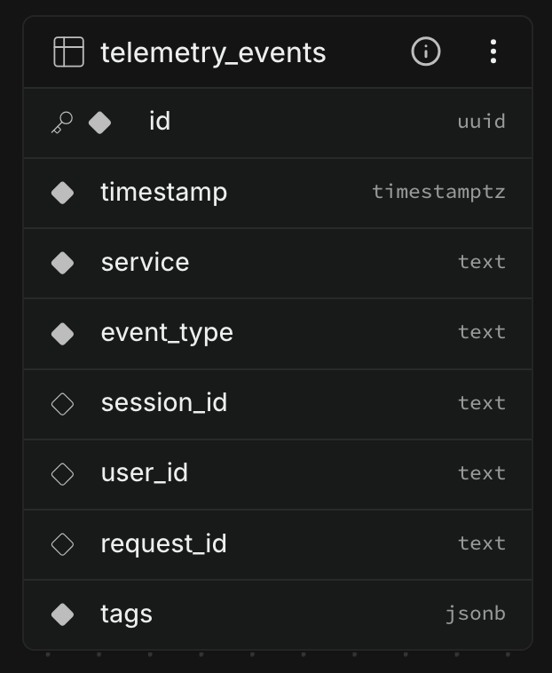
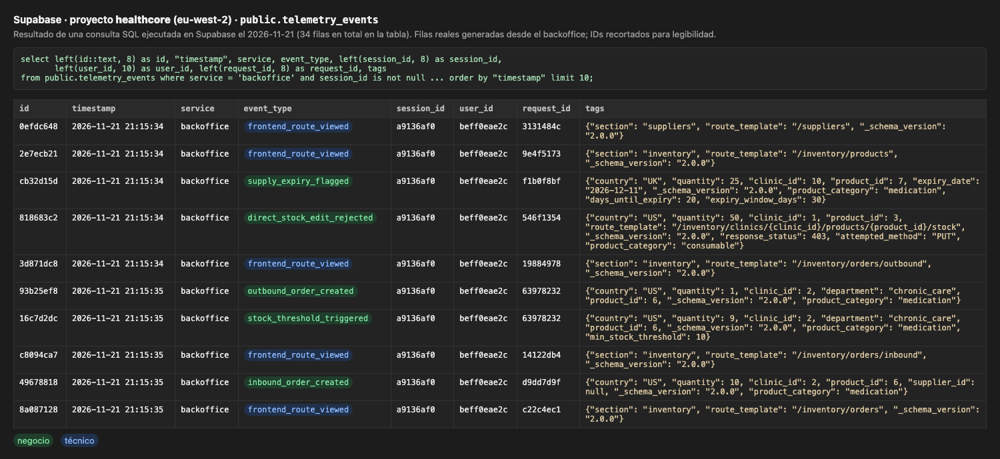

# Telemetría: almacenamiento

`POST /telemetry/events` deja de ser un stub: valida cada evento contra el
contrato `2.0.0` y guarda los válidos en la tabla `telemetry_events` de
Supabase (proyecto `healthcore`, región `eu-west-2`). El frontend no cambia:
misma URL, mismo envelope y una respuesta compatible.

## Tabla `telemetry_events`

Migraciones: [`supabase/migrations/`](../../supabase/migrations/).

| Columna | Tipo | Origen en `TelemetryEvent` |
| --- | --- | --- |
| `id` | `uuid` PK | `eventId` (idempotencia ante reintentos) |
| `timestamp` | `timestamptz` not null | `timestamp` (momento de captura, no de inserción) |
| `service` | `text` not null | Productor; `TELEMETRY_SERVICE`, por defecto `backoffice` |
| `event_type` | `text` not null | `event_type` |
| `session_id` | `text` | `sessionId` (seudónimo) |
| `user_id` | `text` | `userId` (HMAC; nunca el ID de cuenta) |
| `request_id` | `text` | `requestId` |
| `tags` | `jsonb` not null | `properties` (solo claves del allowlist) + `_schema_version` |

- **Índices:** `timestamp`, `event_type` y GIN sobre `tags`.
- **Inmutable:** un trigger rechaza todo `UPDATE` y `DELETE`, incluso del
  propietario. La aplicación no tiene ninguna ruta que actualice o borre.
- **Acceso:**
  - RLS activado; `anon` y `authenticated` no tienen ningún permiso.
  - La API escribe con el rol `telemetry_writer`, que solo puede hacer
    `INSERT` y leer la columna `id`, lo que exige el `ON CONFLICT`. No puede
    leer `tags`, actualizar ni borrar.
- **Dimensiones del BRIEFING:** se conservan en `tags`, por ejemplo
  `tags->>'clinic_id'`, `tags->>'country'`, `tags->>'product_category'` y
  `tags->>'department'`, para agregar por clínica y por país.

## Endpoint

1. **Envelope.** Se lee de forma laxa: un objeto con `events`, una lista de 1 a
   20 elementos crudos. Si no se puede parsear, responde `422` para todo el lote.
2. **Validación por evento**, sin cancelar el resto del lote:
   - Primero el envelope, con `TelemetryEvent.model_validate(raw)`, el mismo
     modelo de la Fase 2 sin cambios.
   - Después el contrato del `event_type` (`services/api/telemetry_contract.json`,
     generado desde `event-schemas.json`): tipo de evento conocido, solo claves
     del allowlist, obligatorias presentes, y tipos, enums, `const`, rangos y
     formatos válidos.
3. **Persistencia.** Todos los válidos se guardan con un único
   `INSERT … ON CONFLICT (id) DO NOTHING`, en una sola sentencia y una sola
   transacción.
4. **Respuesta:** `200 {"received": N, "stored": M, "rejected": R}`, con
   `N = M + R`.
   - Un evento reenviado con el mismo `eventId` ya está guardado: cuenta como
     `stored` y no se duplica.
   - El log separa los nuevos de los duplicados y cuenta los rechazos por
     motivo, sin incluir valores.
5. **Sin almacenamiento** (variable ausente o base caída) responde `503` y el
   cliente reintenta el lote completo.

El backoffice solo comprueba que `received` coincida con el tamaño del lote, por
lo que la respuesta ampliada es compatible.

## Configuración

| Variable | Uso |
| --- | --- |
| `TELEMETRY_DATABASE_URL` | Conexión Postgres del rol `telemetry_writer` por el pooler de transacciones: `postgresql://telemetry_writer.<project_ref>:<password>@aws-1-eu-west-2.pooler.supabase.com:6543/postgres`. Va en `services/api/.env` (ignorado por git) o en el entorno del contenedor. |
| `TELEMETRY_SERVICE` | Opcional; valor de la columna `service`. |

La contraseña de `telemetry_writer` no está en el repositorio. Para cambiarla,
desde el SQL editor de Supabase:
`alter role telemetry_writer with password '<nueva>';`.

Tras modificar `event-schemas.json`, regenerar los contratos de la UI y la API:

```bash
node scripts/generate-telemetry-contract.mjs
node scripts/generate-telemetry-contract.mjs --check
```

## Verificación

- **Tests:** 56 de la API correctos. `test_telemetry_storage.py` cubre:
  - un lote mixto con 2 eventos guardados, 5 rechazados y un solo `INSERT`;
  - un reintento sin duplicar filas;
  - un lote solo con inválidos, que devuelve 200 sin `INSERT`;
  - envelopes no válidos (422) y almacenamiento no configurado (503).
- **Flujo real del backoffice contra Supabase:**
  - El recorrido incluyó login fallido y correcto, vencimientos, ajuste directo
    rechazado, una salida que cruza el mínimo, una salida insuficiente, una
    entrada, el historial, un error no controlado y la latencia.
  - Se guardaron 28 eventos en lotes de 5, 16 y 7, todos con
    `rejected: 0`.
- **Lote mixto enviado con curl** (8 eventos; un rechazo de cada tipo):

  ```json
  {"received":8,"stored":3,"rejected":5}
  ```

  El log registró `{'invalid_envelope': 1, 'unknown_event_type': 1,
  'property_not_allowlisted': 1, 'invalid_property': 1, 'missing_property': 1}`.
- **Permisos de `telemetry_writer`:** `INSERT … ON CONFLICT` permitido; leer
  `tags`, `UPDATE` y `DELETE` denegados.
- **Supabase:** sin avisos de seguridad.

### Esquema en Supabase

Esquema de la tabla en el panel de Supabase (proyecto `healthcore`).



### Filas en `telemetry_events`

Resultado de una consulta SQL en el proyecto `healthcore`: 10 de las 34 filas,
generadas desde el backoffice, con 5 eventos de negocio y 5 técnicos.


