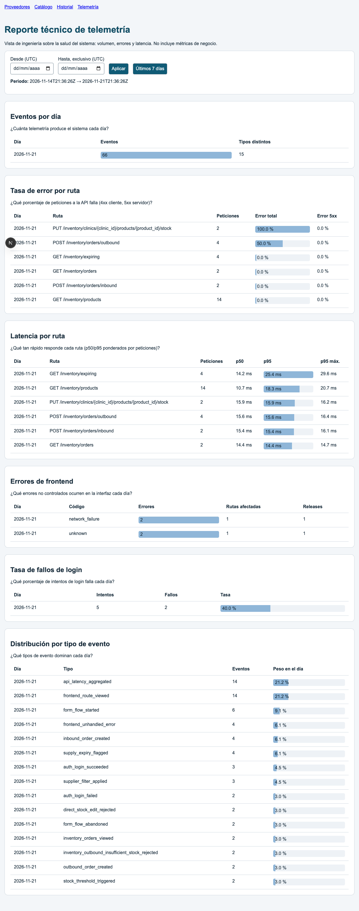

# Telemetría: reporte técnico

`GET /telemetry/report` sirve métricas operacionales calculadas desde
`telemetry_events`: un radar de la salud del sistema (volumen, errores,
latencia, tipos de evento), no un reporte de negocio.

- **Pipeline:** [`services/telemetry/analysis.py`](../../services/telemetry/analysis.py).
- **Endpoint:** `services/api/routes/telemetry.py`.
- **Dashboard:** `/telemetry` en el backoffice.

## Métricas

Todas agrupan por día (UTC) y, cuando aplica, por una dimensión extraída de `tags`.

| Clave | Pregunta operacional | Fuente | Agrupación |
| --- | --- | --- | --- |
| `events_per_day` | ¿Cuánta telemetría produce el sistema cada día y qué tan variada es? | Todos los eventos | día |
| `event_type_distribution` | ¿Qué tipos de evento dominan cada día? | Todos los eventos | día × `event_type` |
| `error_rate_by_type` | ¿Qué porcentaje de peticiones a la API falla, separando 4xx (cliente) de 5xx (servidor)? | `api_latency_aggregated` | día × ruta × método |
| `api_latency_by_route` | ¿Qué tan rápido responde cada ruta (p50/p95 ponderados por peticiones y peor p95)? | `api_latency_aggregated` | día × ruta × método |
| `frontend_errors_per_day` | ¿Qué errores no controlados ocurren en la interfaz y en cuántas pantallas y releases? | `frontend_unhandled_error` | día × `error_code` |
| `auth_failure_rate` | ¿Qué porcentaje de intentos de login falla cada día? | `auth_login_failed` y `auth_login_succeeded` (`IN`) | día |

Notas:

- **Errores 4xx:** incluyen rechazos esperados del negocio, como stock
  insuficiente o el 403 del ajuste directo. `server_error_rate` aísla los 5xx.
- **Latencia:** se mide desde el navegador hasta la API, pasando por el proxy de
  Next.js. Como los eventos ya traen p50/p95 por ventana de 60 s, el día se
  calcula ponderando por `request_count`.

## Pipeline

Cada función sigue el mismo orden: **cargar (SQL) → refinar (Pandas) →
convertir tipos → agrupar → agregar → servir**.

1. **Cargar:** `load_events` aplica en SQL la ventana
   `"timestamp" >= start AND "timestamp" < end` y, si la métrica lo necesita,
   `event_type IN (...)`. Solo trae las columnas necesarias, nunca la tabla
   entera.
2. **Refinar:** `extract_tags` saca de `tags` las dimensiones que la métrica
   necesita y descarta las filas donde alguna es nula.
3. **Convertir:** `with_dates` aplica `pd.to_datetime(..., utc=True)` y deriva
   `date` antes de cualquier `groupby`.
4. **Agrupar y agregar:** solo `groupby()` y `agg()` con `count`, `sum`, `max`,
   `nunique` y `transform`, sin bucles. Las tasas se calculan después como
   columnas.
5. **Servir:** `reset_index()` y `to_dict(orient="records")`, con fechas ISO y
   números de Python nativos.

Las funciones son puras: no tienen estado ni efectos secundarios, y la misma
ventana devuelve el mismo resultado. No aplican ventanas por defecto; la decide
el endpoint.

## Endpoint

`GET /telemetry/report?start_date=…&end_date=…`. Requiere sesión.

- **Parámetros:** ambos son ISO 8601 opcionales; sin zona horaria se interpretan
  como UTC.
  - Por defecto: `end_date` = ahora (UTC) y `start_date` = `end_date` − 7 días.
  - La ventana `[start, end)` se resuelve una sola vez y se pasa a todas las
    métricas.
  - Devuelve 422 si `start_date >= end_date` o si la ventana supera 93 días.
- **Respuesta:** `{"period": {"from", "to"}, "metrics": {...}}`.
- **Caché:** en memoria, con un TTL de 60 s por combinación de parámetros.
  - La petición por defecto también se reutiliza durante esos 60 s, en lugar de
    recalcular con un `now()` distinto.
  - Medido con datos reales: 2,1 s la primera petición y 2 ms la siguiente.
- **Errores:** 503 si no hay conexión de lectura.

## Acceso a datos

El reporte lee con el rol `telemetry_reader`
(`supabase/migrations/20261122100000_telemetry_reader_role.sql`).

- **Puede:** leer `timestamp`, `event_type` y `tags`.
- **No puede:** leer los identificadores seudónimos (`session_id`, `user_id`,
  `request_id`) ni escribir.

| Variable | Uso |
| --- | --- |
| `TELEMETRY_REPORT_DATABASE_URL` | `postgresql://telemetry_reader.<project_ref>:<password>@aws-1-eu-west-2.pooler.supabase.com:6543/postgres` en `services/api/.env` |

## Verificación

- **Tests:** 16 en `test_telemetry_report.py`, con SQLite y datos de dos días
  calculados a mano. Cubren:
  - cada métrica y su determinismo;
  - la ventana `[start, end)`, que excluye los bordes;
  - que las filas sin la dimensión se descartan;
  - la serialización JSON y las ventanas vacías;
  - la ventana por defecto de 7 días;
  - el caché (mismos parámetros → un cálculo; tras 61 s → recalcula);
  - las validaciones 422, la autenticación 401 y el 503 sin base de datos.
- **Datos reales:** reporte calculado sobre `telemetry_events` en Supabase con
  eventos generados desde el backoffice.
- **Docker:** la imagen de la API se construye con `services/telemetry` y Pandas.

